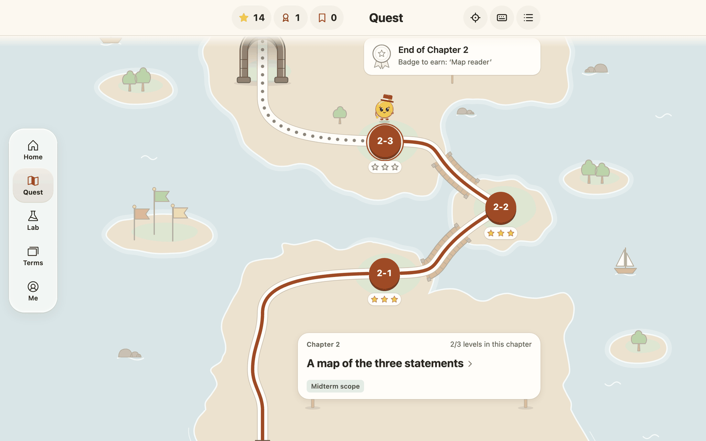
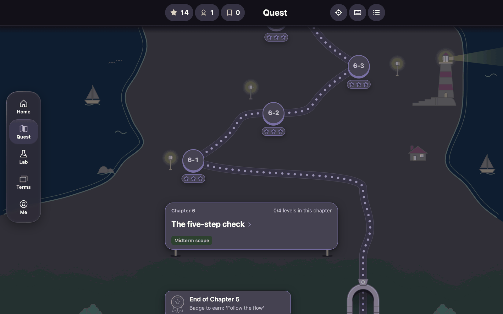
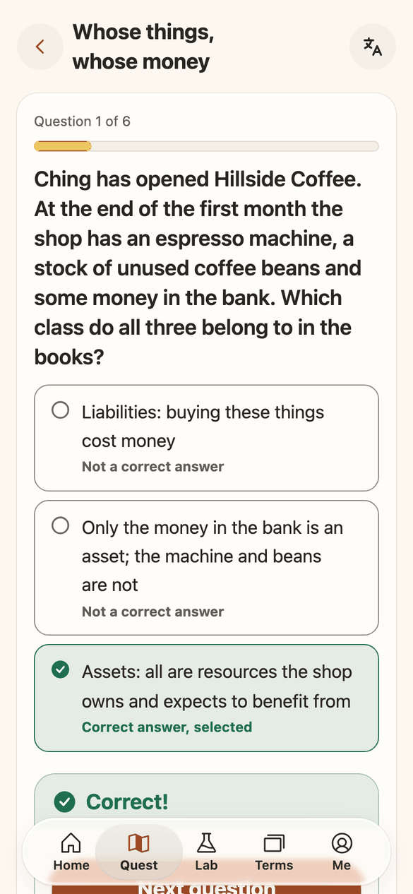
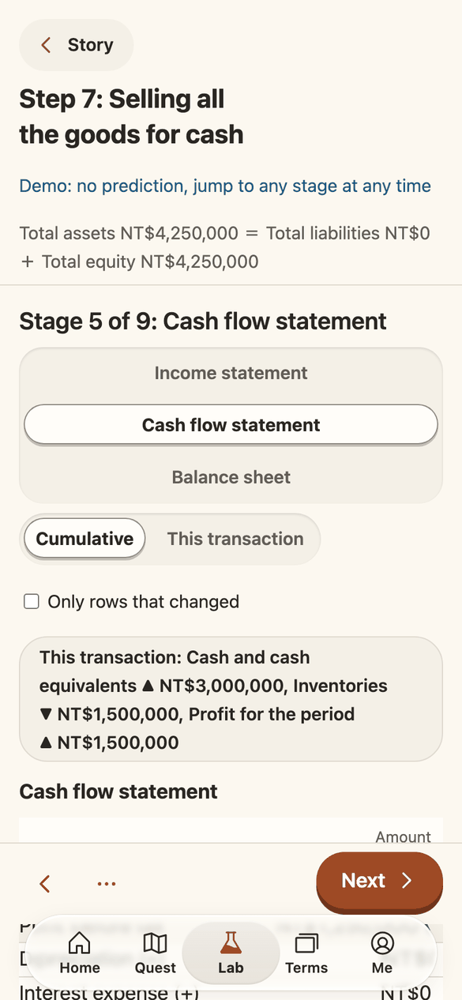
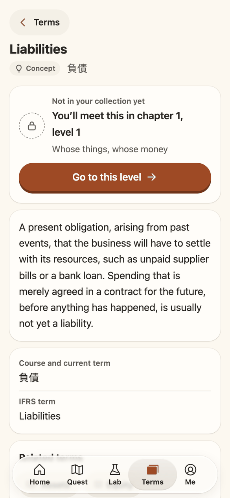
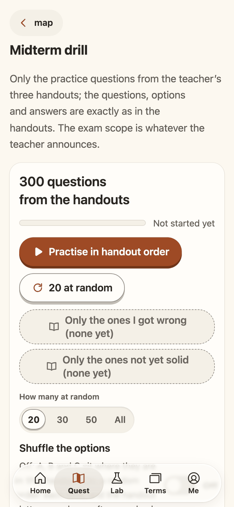

<div align="center">


# LedgerLand

**The books of one small shop, walked as a map.**

[繁體中文](README.md) ｜ English

<p>
  <a href="https://ledgerland.swift.moe/en/"></a>
  
  <a href="README.md"></a>
  
</p>

<p>
  
  
  
  
  
</p>

[](https://github.com/swiftruru/ledger-land/actions/workflows/ci.yml)

</div>

> A cup of coffee is sold: cash comes in, stock goes down a little.  
> Every transaction is a small story,  
> and debit and credit are its two lines.  
> Gather the stories and you have the statements;  
> read the statements and you can see a shop through its seasons.

The Chinese README is the primary version; this page follows it.

## What it is

LedgerLand is a learning site for people new to accounting: public, open source, mobile first and bilingual (Chinese at the root path, English under `/en/`). It starts from the books of one small shop and works up to assets, liabilities, equity and the three financial statements. Once added to the home screen it works offline. There are no accounts; your progress stays on your own device.

- Live site: https://ledgerland.swift.moe/en/
- Planning documents (in Chinese): [`docs/PLAN.md`](docs/PLAN.md) and [`docs/plan/`](docs/plan/); milestone reports in [`docs/reports/`](docs/reports/)
- Contributing: [`CONTRIBUTING.md`](CONTRIBUTING.md); security reports: [`SECURITY.md`](SECURITY.md)

## A walk through the land

<p align="center">
  <a href="https://ledgerland.swift.moe/en/play/"></a>
</p>

The quest map runs from the bottom upwards. Chapter 1 is a small shop; through the arch lie the islands of chapter 2, joined by wooden bridges, with flags and sailing boats in the distance. The road you have walked keeps its colour, each level holds up to three stars, and Rin the coin girl waits for you on your next level.

<p align="center">
  
</p>

Switch to the dark theme Night Sky and the lighthouse on the coast of chapter 6 lights up, with the street lamps glowing one by one. There are four looks in all: a paper light theme, and three dark flavours called Night Sky, Berry and Wine.

## What you will find

<table>
  <tr>
    <th width="25%">Quest</th>
    <th width="25%">Statement lab</th>
    <th width="25%">Glossary</th>
    <th width="25%">Midterm drill</th>
  </tr>
  <tr>
    <td></td>
    <td></td>
    <td></td>
    <td></td>
  </tr>
  <tr>
    <td valign="top">14 chapters, 47 levels and 281 original questions. Every answer gets an explanation straight away; the ones you get wrong go into a review book and come back to find you a few days later.</td>
    <td valign="top">Eighteen transactions of one company, followed step by step into the income statement, the cash flow statement and the balance sheet. You can also change the numbers and experiment.</td>
    <td valign="top">163 terms, collected as you meet them in the levels. Each card has a plain explanation and sets the course wording beside the IFRS wording.</td>
    <td valign="top">The 300 practice questions from the teacher’s three handouts, word for word (in Chinese only): in order, at random, as a mock exam or as a page to browse, with the ones you missed or have not yet got solid kept aside.</td>
  </tr>
</table>

A few smaller things:

- **Stars, badges and a timer**: up to three stars per level and a badge for each finished chapter; switch on the timer when you want a little pressure.
- **Progress you can carry**: export your progress as a backup file or a backup code and take it to another device.
- **For everyone**: every page is checked with axe, every flow can be completed with the keyboard alone, and the system setting for reduced motion is respected.
- **Original content**: the questions, explanations and glossary cards are newly written and shared under a Creative Commons licence; material used with the teacher’s permission is marked separately (see [Licences](#licences)).

## Two residents

<table>
  <tr>
    <td align="center" width="50%"></td>
    <td align="center" width="50%"></td>
  </tr>
  <tr>
    <td valign="top"><b>Little Green Girl（小綠綠）</b>: the girl hugging a red ledger. She lives on the app icon and the launch screen; add the site to your home screen and she is the first to greet you.</td>
    <td valign="top"><b>Rin（鈴）</b>: a coin girl with a small top hat worn at an angle, named after the clear ring of a falling coin. She walks every level with you on the map and keeps watch on the browser tab.</td>
  </tr>
</table>

Both are original characters of this project.

## Where the project is

| Milestone               | What                                                                                                  | Status |
| ----------------------- | ----------------------------------------------------------------------------------------------------- | ------ |
| M0b Foundations         | monorepo, CI and deployment, the shell, design tokens, bilingual structure                            | Done   |
| M1 Accounting core      | chart of accounts, transaction templates, the three statements, ratios, the five reconciliation steps | Done   |
| M2, M3 Quest            | the chapters in the midterm scope, question types, glossary, badges, the quest map                    | Done   |
| M4a Statement lab (one) | story and animation, predictions, free experiments, reconciliation practice, ratio panel              | Done   |
| M4c Midterm drill       | handout question bank, mock exam, browsing page, mastery marks                                        | Done   |
| M4b Statement lab (two) | a formula tree for ‘where does this number come from’, an IFRS comparison                             | Next   |

The full plan and the later milestones are in [`docs/plan/10-milestones.md`](docs/plan/10-milestones.md) (in Chinese).

## What it is made with

<p>


</p>

```text
apps/web                the learner PWA (shell, routes and pages, Service Worker and manifest, _headers template, wrangler config)
packages/core           accounting core: chart of accounts, transaction templates, posting, the three statements, ratios, reconciliation
packages/quiz           question types and marking
packages/progress       progress, review scheduling, backup
packages/tokens         the single source of design tokens (paper light and three dark flavours, type scale, spacing, motion, breakpoints)
packages/i18n           locale registry, locale functions for URLs, formatting, answer input normalisation
packages/content-schema Zod schemas for the content, exported as JSON Schema to schemas/
packages/web-ui         shared React components and their Lingui catalogues
tools                   build-time tools and check scripts
content                 content sources (one record per file, all languages in the same file)
schemas                 JSON Schema generated from Zod
docs                    planning documents and milestone reports
```

## Local development

```bash
source tools/env.sh
pnpm install --frozen-lockfile
pnpm content:build
pnpm --filter @ledgerland/web dev
```

Packages, the store, caches and test browsers all stay inside the repository (`.pnpm-store/`, `.cache/`); nothing is installed globally. See `CONTRIBUTING.md` for details. Common checks: `pnpm typecheck`, `pnpm lint`, `pnpm test`, `pnpm content:check`, `pnpm e2e`.

## Licences

| Path                                                                                                            | What                                                                | Licence                                                                                                            |
| --------------------------------------------------------------------------------------------------------------- | ------------------------------------------------------------------- | ------------------------------------------------------------------------------------------------------------------ |
| `apps/`, `packages/`, `tools/`, config files                                                                    | Code                                                                | [MIT](LICENSE)                                                                                                     |
| Accounting core data (chart of accounts, transaction templates, ratio registry, layouts): `packages/core/data/` | Program data                                                        | [MIT](LICENSE)                                                                                                     |
| Questions, terms, chapters and story narration in `content/`                                                    | Original teaching content                                           | [CC BY-SA 4.0](LICENSES/CC-BY-SA-4.0.txt)                                                                          |
| Story scenario and amounts from the teacher in `content/stories/` (since M1)                                    | Material used with the teacher’s permission                         | Used with permission from Dr Yen-Hung Chen (陳彥宏); not covered by the CC licence; ask the teacher before reusing |
| `docs/`                                                                                                         | Planning and technical documents                                    | Same as the teaching content (CC BY-SA 4.0)                                                                        |
| Third-party packages and icons                                                                                  | React, Lingui, Phosphor and others                                  | Their own licences, listed in [`THIRD_PARTY_NOTICES.md`](THIRD_PARTY_NOTICES.md)                                   |
| The teacher’s course materials                                                                                  | Slides, Excel files and other materials                             | Not included, not distributed; this site’s licences do not cover them                                              |
| Handout question bank `content/handout/`                                                                        | The practice questions of the three midterm handouts, word for word | Used with permission from Dr Yen-Hung Chen (陳彥宏); not under CC BY-SA; ask the teacher before reusing            |

Attribution format when reusing original content (title, author, source, licence):

```text
‘Glossary card: Assets’, LedgerLand contributors, https://ledgerland.swift.moe/, CC BY-SA 4.0
```

## Name and marks

The name ‘LedgerLand 會計樂園’, its marks and the app icon are reserved and are not granted under MIT or CC BY-SA. Adapted or forked versions should use a different name and marks and must not imply that they are the official LedgerLand. See [`NOTICE`](NOTICE).

<div align="center">

<p>
  <a href="LICENSE"></a>
  <a href="LICENSES/CC-BY-SA-4.0.txt"></a>
  
  <a href="https://swift.moe"></a>
</p>

May every statement you learn to read feel like a road you have walked.

</div>
