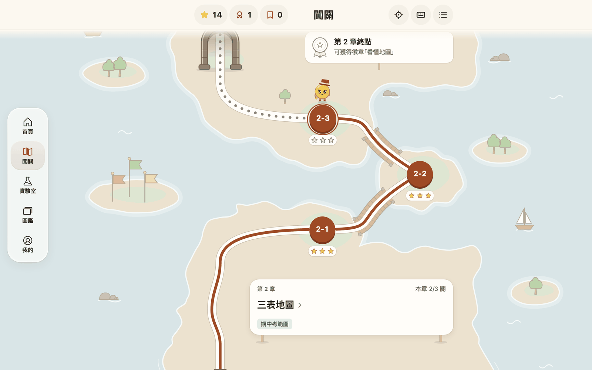
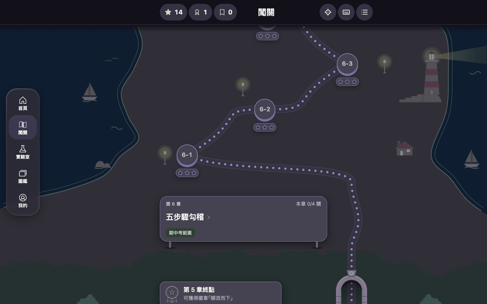
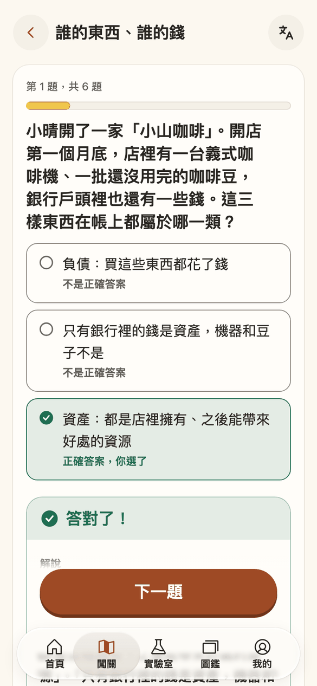
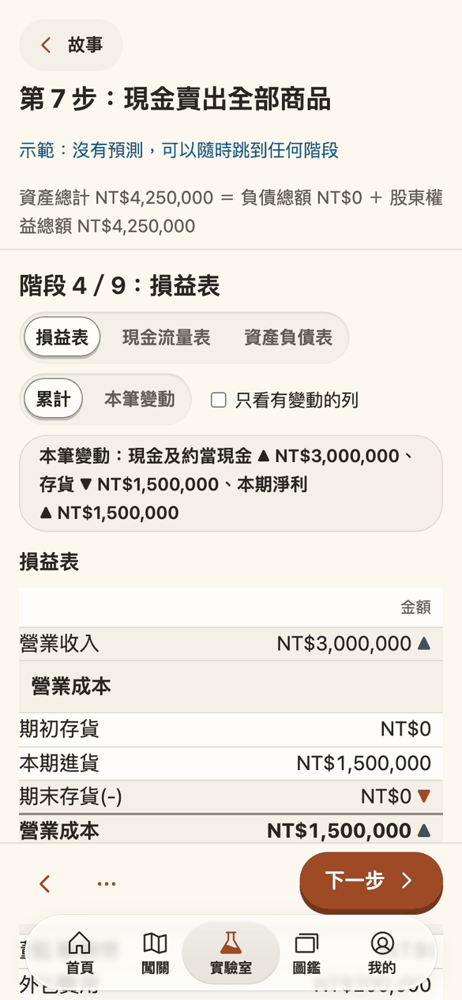
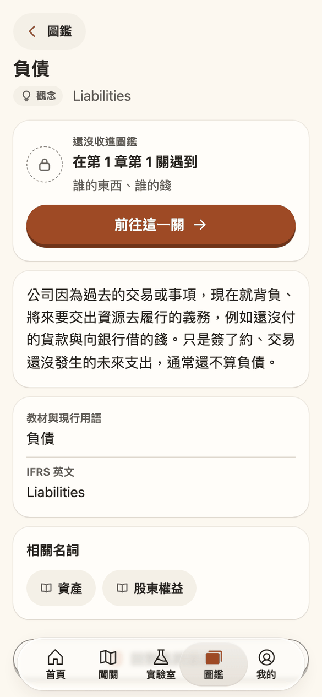
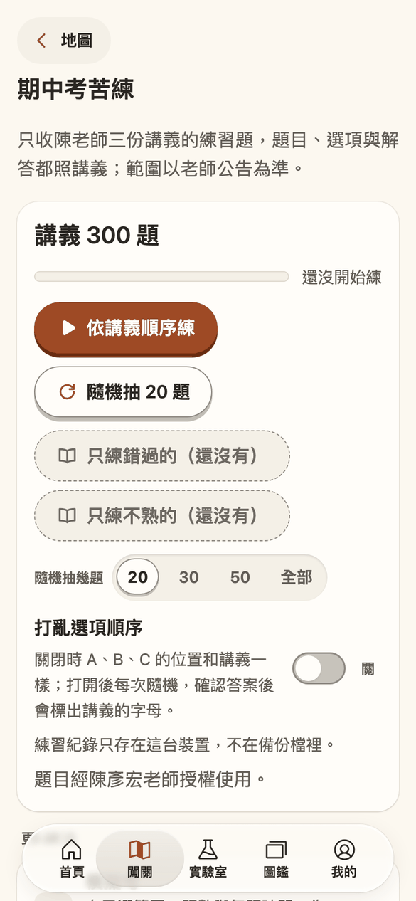

<div align="center">


# LedgerLand 會計樂園

**把一家小店的帳，走成一張地圖。**

繁體中文 ｜ [English](README.en.md)

<p>
  <a href="https://ledgerland.swift.moe/"></a>
  
  <a href="README.en.md"></a>
  
</p>

<p>
  
  
  
  
  
</p>

[](https://github.com/swiftruru/ledger-land/actions/workflows/ci.yml)

</div>

> 一杯咖啡賣出去，現金進來，存貨少了一點。  
> 每一筆交易都是一則小故事，  
> 借方與貸方，是它的上句與下句。  
> 把故事一則一則收好，就成了報表；  
> 把報表一張一張讀懂，就看見一家店的四季。

## 這是什麼

LedgerLand 會計樂園是給會計新手的學習網站：公開、開源、手機優先、中英雙語（中文在根路徑、英文在 `/en/`）。從一家小店的帳開始，認識資產、負債、股東權益與三大財務報表。裝到主畫面後可以離線使用；不需要帳號，進度留在你自己的裝置上。

- 正式網址：https://ledgerland.swift.moe/
- 規劃文件：[`docs/PLAN.md`](docs/PLAN.md) 與 [`docs/plan/`](docs/plan/)；里程碑回報在 [`docs/reports/`](docs/reports/)
- 貢獻方式：[`CONTRIBUTING.md`](CONTRIBUTING.md)；資安回報：[`SECURITY.md`](SECURITY.md)

## 走一趟樂園

<p align="center">
  <a href="https://ledgerland.swift.moe/play/"></a>
</p>

闖關地圖由下往上走。第 1 章是一家小店，過了拱門是第 2 章的群島：島與島之間有木橋，遠處有旗子與帆船。走過的路會留下顏色，每一關最多三顆星，金幣少女「鈴」站在你的下一關等你。

<p align="center">
  
</p>

換上深色主題「夜空」，第 6 章海岸的燈塔會亮起來，路燈也一盞一盞點著。外觀一共四種：紙質的淺色，以及夜空、莓果、紅酒三種深色。

## 樂園裡有什麼

<table>
  <tr>
    <th width="25%">闖關</th>
    <th width="25%">報表實驗室</th>
    <th width="25%">名詞圖鑑</th>
    <th width="25%">期中考苦練</th>
  </tr>
  <tr>
    <td></td>
    <td></td>
    <td></td>
    <td></td>
  </tr>
  <tr>
    <td valign="top">14 章 47 關、281 題原創題目。答完立刻有解說；答錯的題收進錯題本，隔幾天再回來找你。</td>
    <td valign="top">一家公司的 18 筆交易，一步一步看它怎麼流進損益表、現金流量表與資產負債表。也可以自己改數字做實驗。</td>
    <td valign="top">163 個名詞，在關卡裡遇到就收進圖鑑。每張卡有白話的解釋，並對照教材與 IFRS 的用語。</td>
    <td valign="top">陳彥宏老師三份講義的 300 題練習題原文：照順序練、隨機抽、模擬考、背題瀏覽，錯過與還不熟的題另外收好。</td>
  </tr>
</table>

還有一些小地方：

- **星星、徽章與計時**：每一關最多三顆星，走完一章有一枚徽章；想要一點壓力時可以打開計時。
- **帶得走的進度**：進度可以匯出成備份檔或備份碼，換裝置時帶著走。
- **誰都能用**：每一頁用 axe 檢查，流程可以只用鍵盤完成，也尊重系統「減少動態效果」的設定。
- **原創的內容**：題目、解說與名詞卡都是重新寫的，以創用 CC 授權分享；老師授權的素材另外標示（見[授權](#授權)）。

## 兩位住民

<table>
  <tr>
    <td align="center" width="50%"></td>
    <td align="center" width="50%"></td>
  </tr>
  <tr>
    <td valign="top"><b>小綠綠</b>：抱著紅色帳本的女孩，住在 App 圖示與啟動畫面上。把網站加到主畫面，第一個迎接你的就是她。</td>
    <td valign="top"><b>鈴（Rin）</b>：一枚歪戴小禮帽的金幣少女，名字取自金幣落下的清脆聲。她在地圖上陪你走每一關，也守在瀏覽器的分頁上。</td>
  </tr>
</table>

兩位都是這個專案的原創角色。

## 目前走到哪裡

| 里程碑               | 內容                                             | 狀態   |
| -------------------- | ------------------------------------------------ | ------ |
| M0b 基礎建設         | monorepo、CI 與部署、殼層、設計 tokens、雙語架構 | 已完成 |
| M1 會計核心          | 科目表、交易範本、三表、指標、五步驟勾稽         | 已完成 |
| M2、M3 闖關區        | 期中考範圍的章節、題型、名詞圖鑑、徽章、闖關地圖 | 已完成 |
| M4a 報表實驗室（一） | 故事與動畫、預測、自由實驗、勾稽練習、指標面板   | 已完成 |
| M4c 期中考苦練       | 講義題庫、模擬考、背題瀏覽、熟練標記             | 已完成 |
| M4b 報表實驗室（二） | 「這個數字從哪裡來」的公式樹、IFRS 對照          | 下一站 |

完整的進度與之後的里程碑見 [`docs/plan/10-milestones.md`](docs/plan/10-milestones.md)。

## 用什麼做的

<p>


</p>

```text
apps/web                學習端 PWA（殼層、路由與頁面、Service Worker 與 manifest、_headers 範本、wrangler 設定）
packages/core           會計核心：科目表、交易範本、過帳、三表、指標、五步驟勾稽
packages/quiz           題型與判分
packages/progress       進度、錯題本的排程、備份
packages/tokens         設計 token 的唯一來源（紙質淺色與深色三風味、字級、間距、動態、斷點）
packages/i18n           語系登錄檔、網址的語系函式、格式化、作答輸入正規化
packages/content-schema 內容的 Zod schema，輸出 JSON Schema 到 schemas/
packages/web-ui         共用的 React 元件與其 Lingui 字串檔
tools                   建置期工具與檢查腳本
content                 內容的原始檔（一筆一檔，多語系同一檔）
schemas                 由 Zod 產生的 JSON Schema
docs                    規劃文件與里程碑回報
```

## 本機開發

```bash
source tools/env.sh
pnpm install --frozen-lockfile
pnpm content:build
pnpm --filter @ledgerland/web dev
```

套件、store、快取與測試瀏覽器都只放在 repo 內（`.pnpm-store/`、`.cache/`），不做全域安裝；細節見 `CONTRIBUTING.md`。常用的檢查：`pnpm typecheck`、`pnpm lint`、`pnpm test`、`pnpm content:check`、`pnpm e2e`。

## 授權

| 路徑                                                                      | 內容                       | 授權                                                                    |
| ------------------------------------------------------------------------- | -------------------------- | ----------------------------------------------------------------------- |
| `apps/`、`packages/`、`tools/`、設定檔                                    | 程式碼                     | [MIT](LICENSE)                                                          |
| 會計核心資料（科目表、交易範本、指標登錄檔、版面）：`packages/core/data/` | 程式資料                   | [MIT](LICENSE)                                                          |
| `content/` 的題目、名詞、章節、故事的敘述文字                             | 原創教學內容               | [CC BY-SA 4.0](LICENSES/CC-BY-SA-4.0.txt)                               |
| `content/stories/` 中來自老師的故事情境與金額（M1 起）                    | 老師授權使用的素材         | 經陳彥宏老師授權使用，不在 CC 授權範圍內；重用前要另外取得老師同意      |
| `docs/`                                                                   | 規劃與技術文件             | 與教學內容相同（CC BY-SA 4.0）                                          |
| 第三方套件與圖示                                                          | React、Lingui、Phosphor 等 | 各自原本的授權，列在 [`THIRD_PARTY_NOTICES.md`](THIRD_PARTY_NOTICES.md) |
| 老師的教材                                                                | 投影片、Excel 與其他教材   | 不收錄、不散布，本站的授權不涵蓋                                        |
| 講義題庫 `content/handout/`                                               | 期中考三份講義的練習題原文 | 經陳彥宏老師授權使用，不在 CC BY-SA 內；重用前要另外取得老師同意        |

重用原創內容時的署名格式（標題、作者、來源、授權）：

```text
〈名詞卡：資產〉，LedgerLand 會計樂園貢獻者，https://ledgerland.swift.moe/，CC BY-SA 4.0
```

## 名稱與標誌

「LedgerLand 會計樂園」的名稱、標誌與 App 圖示另外保留，不隨 MIT 與 CC BY-SA 授出。改作或 fork 的版本請改用其他名稱與標誌，不得暗示是 LedgerLand 官方版本。詳見 [`NOTICE`](NOTICE)。

<div align="center">

<p>
  <a href="LICENSE"></a>
  <a href="LICENSES/CC-BY-SA-4.0.txt"></a>
  
  <a href="https://swift.moe"></a>
</p>

願你讀懂的每一張報表，都像走過的一段路。

</div>
