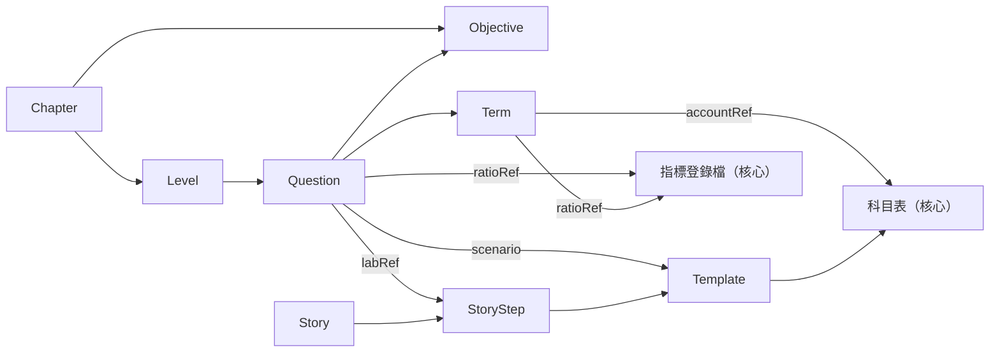
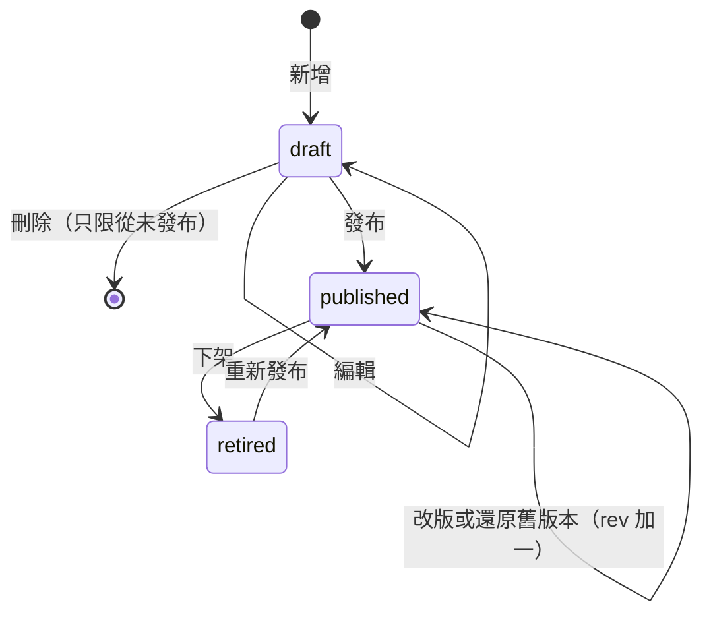
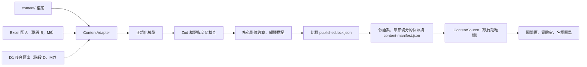

# 08 題庫管理與管理後台

這份文件說明 LedgerLand 的內容（題目、名詞卡、術語、交易範本、章節、關卡、故事）怎麼寫、怎麼存、怎麼檢查、怎麼發布，以及日後讓不寫程式的人也能維護題庫的幾條路。核心想法是「內容即資料」：所有內容都是有 schema 的結構化資料，「發布」就是產生一份靜態快照，學習端只讀快照、永遠不需要登入。Excel 匯入與管理後台都只是「產生同一份快照」的不同入口，所以分階段加上去：2026-10-20 已決定 M6 加 Excel 範本與本機匯入指令（D10(d)），M7 直接做 Cloudflare Access 加 Workers 加 D1 的資料庫型後台（D10(e)），不經過 Git-based CMS。

## 確定要做

- **原創政策**：老師教材只當觀念與學習目標的地圖；建立觀念覆蓋表；訂出改寫標準；內容資料不記錄教材頁碼或題號；相似度檢查只在本機執行、結果不 commit；所有內容走審稿清單（第 1 節）。唯一的例外是報表實驗室的故事：已決定（D2，2026-10-20）照老師的情境與金額（老師已同意），敘述文字仍用網站自己的話撰寫，並標示「經陳彥宏老師授權使用」（D6）。
- **內容模型**：內容放在 `content/`，每種實體一份 Zod schema（放在 `packages/content-schema`），另由 Zod 產生 draft-07 JSON Schema 到 `schemas/`；題目、名詞、交易範本、故事的型別與題型代號以 04 為準，本文件補上管理欄位並定義章節、學習目標、關卡；名詞同時是術語表的唯一來源（第 2、3 節）。
- **題型範圍**：已決定（D1，2026-10-20）借貸分錄題 `journal_entry` 只用在「借貸與分錄」延伸章（`scope: "extension"`，不列入期中考範圍）；已決定（D12，2026-10-20）新增多正解題型 `multi_choice`，必填判分方式 `scoringMode`（`any_correct` 或 `all_correct`），M2 與單選題共用元件一起實作（3.6 節）。
- **狀態只有三種**：已決定（D10(g)，2026-10-20）不設 review（待審）狀態，只有 `draft`、`published`、`retired`（6.5 節）。
- **穩定 ID 與改版**：學習內容的 ID 隨機產生，會計核心詞彙（科目、版面列、指標、交易範本等）用語意 ID，兩者都建立後不變、永不重用；每次改版加 `rev` 並標 `revKind`；選項 ID 穩定；`published.lock.json` 是唯一的比對基準；下架用 `retired` 加 `supersededBy`；學習進度以「id 加 rev」記錄（第 4 節）。
- **自動驗證**：分成結構、多語系、引用、會計（由核心計算）、答案、ID 穩定性、文字風格七組，在本機與 CI 執行，發布前擋下錯誤（第 5 節）。
- **內容生命週期**：對應你用的詞（草稿、預覽、發布、下架、還原舊版本、刪除）；從未發布的草稿可以真正刪除，發布過的只能下架（第 6 節）。
- **兩層內容抽象**：建置期的 ContentAdapter（現在只有檔案一種，M6 加 `xlsx`、M7 加 `d1`）與執行期唯讀的 ContentSource（只讀隨網站部署的快照）（第 7 節）。
- **受控標記**：說明文字只允許受控標記，在建置期編譯成 AST，不允許原始 HTML（第 8 節）。
- **共同原則**：發布等於靜態快照、學習端不登入、學習端不載入驗證 SDK、已發布的答案必然公開、後台放在獨立 origin、權限在伺服器端檢查（第 12 節）。
- **Excel 範本與本機匯入（階段 B，M6）**：已決定（D10(d)，2026-10-20）文字型題目（含 `multi_choice`）與名詞用 Excel 範本維護；上傳入口先做本機匯入指令；老師要自己操作時，再加「只產出檔案」的瀏覽器匯入頁，放在後台的獨立 origin。含 `scenario` 的計算題、交易範本與故事仍維護在 JSON（第 9、10 節）。
- **資料庫型後台（階段 D，M7）**：已決定（D10(e)，2026-10-20）直接用 Cloudflare Access 加 Workers 加 Cloudflare D1 資料庫，不經過 Git-based CMS 階段（階段 C 不做）。本文件提到資料庫時簡稱「D1」；決定編號 D1（借貸分錄）只出現在借貸分錄與 `journal_entry` 的段落，寫成「（D1）」、「（D1，2026-10-20）」或「決定 D1」。後台放在獨立 origin；Worker 驗證 Access 的 JWT 後再查 D1 的角色表；發布時輸出靜態快照；版本紀錄與還原用 D1 的 `revisions` 表，D1 Time Travel 只當災難還原；Access 的獨立兩步驟驗證能否在免費方案使用【待實測 V10】，不行就改用 IdP 的兩步驟驗證並在 M7 前回報（11.6 節）。
- **草稿與後台資料不進公開 repo**：已決定（D3，2026-10-20）repo 公開。M0b 到 M6 期間 `content/` 裡的草稿是公開的；M7 起透過後台編輯的草稿、角色表與稽核紀錄只存在 D1，公開 repo 只收到已發布內容的匯出（6.1、11.6 節）。
- **遠端快照來源先不做**：已決定（D10(e)，2026-10-20）發布由後台觸發重新建置與部署，快照隨網站部署；RemoteSnapshotSource 等重新部署真的太慢時再評估（7.5 節）。
- **階段 A**：M0b 到 M5 期間，內容以「檔案加 CI 驗證」維護（第 13 節）。

## 需評估

D 系列與本文件有關的項目已在 2026-10-20 全部決定，內容併入上面的「確定要做」；下表保留決定紀錄與未採用的選項，細節見各節。

| 項目 | 已決定 | 未採用的選項與理由 |
| --- | --- | --- |
| review（待審）狀態（第 6.5 節） | 已決定（D10(g)，2026-10-20）：不設，只有 draft、published、retired | B 加 `review`：一人維運時形同多一道手續，等老師或第二個人要正式審核時再加；C CMS 流程標籤：不使用 CMS，不適用 |
| 維護方式（第 9 節） | 已決定（D10(d)，2026-10-20）：Excel 範本來回，只涵蓋文字型題目與名詞 | A 只編 JSON：不寫程式的人不容易上手（JSON 仍用在計算題、範本與故事）；C Google Sheets：要設定 service account 與權限，目前不需要多人同時編輯 |
| 上傳入口（第 10 節） | 已決定（D10(d)，2026-10-20）：先做本機匯入指令（M6）；老師要自己操作時加「只產出檔案」的瀏覽器匯入頁（後台獨立 origin） | PR 上的 GitHub Action：協作者要有 GitHub 帳號，而且匯入檔會永久留在公開歷史 |
| 後台方案與時程（第 11、13 節） | 已決定（D10(e)，2026-10-20）：Cloudflare Access 加 Workers 加 D1，M7 | Sveltia、Decap、Supabase、Firebase、自架列為「比較過、未採用」，理由見 11.6 節 |
| 遠端快照來源 RemoteSnapshotSource（第 7.5 節） | 已決定（D10(e)，2026-10-20）：先不做，發布時重新部署 | B 先做：多了 CORS、CSP、版本相容與首次離線的問題，目前沒有「重新部署太慢」的實際困擾 |
| 借貸分錄題型（第 3.6 節） | 已決定（D1，2026-10-20）：(b) 延伸層，`journal_entry` 只用在「借貸與分錄」延伸章 | (a) 不做：沒有需求中的分錄題；(c) 主線：與教材的倒推法衝突最大 |
| 一題多個正解的處理（第 3.6 節） | 已決定（D12，2026-10-20）：新增 `multi_choice`，必填 `scoringMode` | A 一律改寫成單一正解：會失去「不只一個合理答案」的教學價值 |

仍待老師回覆、目前先照預設做法的一項：

| 項目 | 選項 | 主要取捨 | 目前做法 | 狀態 |
| --- | --- | --- | --- | --- |
| 解說觀點的署名（第 3.6 節） | A 一律寫成網站觀點；B 經老師同意後標示老師觀點 | A 不必老師逐題確認，但少了老師的權威；B 學生較信服，但老師要逐題確認文字，也等於替內容背書 | A，直到老師回覆 | 【待確認 T37】 |

---

## 1. 原創政策

### 1.1 原則

1. **教材是地圖，不是素材庫**。老師教材告訴我們「要教哪些觀念、學生常卡在哪裡」，網站的題目、情境、數字、干擾選項與解說全部重新撰寫。
   - **故事例外**：已決定（D2，2026-10-20）報表實驗室的故事照老師的情境與金額（你轉達老師已同意）。故事的敘述文字、交易卡、預測題與利害關係人卡仍用網站自己的話撰寫；第 12 筆等疑似誤植依 13 的建議處理，並在該步驟加註說明。故事的情境與金額不在內容的 CC BY-SA 4.0 授權範圍內，畫面與授權說明標示「經陳彥宏老師授權使用」（D6，見 3.9 節）。故事沒有涵蓋的交易（延伸章、自由實驗等）需要情境時，另外建立原創情境。
   - **以故事狀態出題**：題目的 `scenario.opening` 用 `{ storyRef, afterStep }` 從故事某一步之後的狀態出題時，畫面會帶出故事的金額，這是允許的；其他題目的情境與數字一律自編。
2. **用詞例外**。科目名稱、指標名稱與公式依教材（你的原則是「用詞跟著教材走」），這些屬於專業術語，不在原創性要求的範圍內；術語的現行用語與 IFRS 英文放在術語表（見 [12 術語表](12-glossary.md)）。
3. **題數依觀念估算**。不以教材題數一對一轉寫，而是依觀念覆蓋表（1.2 節）估算每個學習目標需要幾題原創題。
4. **答案會隨真正懸而未決的事項改變的觀念，先不出計分題**。已決定（2026-10-23）：T 系列（例如存貨盤盈的入帳方式【待確認 T06】、遞延資產與攤銷【待確認 T04】【待確認 T05】）已全部由規劃者依專業判斷決定並寫在 14，題目照決定出題並正常計分，解說可以連到 14 的「設計說明」；老師回饋後只改資料。機制保留：日後若出現真正懸而未決、會改變正解的事項，在題目層級的 `pendingRefs` 列出編號，這一題就標記為「答案可能因懸而未決的事項而改變、暫不計分」（3.6 節）；目前沒有這種題目。只牽涉名稱或用詞的事項（例如現金流量表中利息相關列的名稱【待確認 T11】），照決定顯示，名詞卡加註即可。判斷方式見 5.4 節的 `acct.pendingBlocked`。分錄題另有一道關卡：交易範本的 `entryQuestionBlockedBy` 列出編號時，不得用它出分錄題（3.8 節；目前沒有範本使用）；`pendingRefs` 與 `entryQuestionBlockedBy` 兩者並存、用途不同。
5. **選項一律打散**。題目資料裡的選項順序沒有意義，作答時隨機排列；解說只用選項 ID 引用選項（第 8 節的 `{{option:o_id}}`），不寫「選項 A」。

### 1.2 觀念覆蓋表

觀念覆蓋表是原創內容的「生產計畫」。它由學習目標（Objective）資料加上自動產生的統計報表組成：

- 學習目標放在 `content/objectives/<chapterId>.json`，用原創文字描述「學生學完要能做到什麼」，並列出常見迷思（干擾選項的來源）與預計題數。
- 學習目標與教材頁碼的對照**只放在文件 01**（[01 教材整理](01-materials.md)（本機專用）），不進內容資料。已決定（D3，2026-10-20）：repo 公開，文件 01 與 13 留在原位，以 `.gitignore` 排除、只存在本機（由你備份），不 commit、不搬移。
- `pnpm content:coverage` 依學習目標與題目資料產生報表：每個目標的預計題數、草稿數、已發布數、題型分布、難度分布。報表輸出到建置資料夾，不 commit；PR 上由 CI 貼出摘要。

覆蓋表的欄位：

| 欄位 | 說明 |
| --- | --- |
| objectiveId | 學習目標 ID（隨機產生，見第 4 節） |
| 章節 | 所屬章節（chapterId） |
| 學習目標 | 原創敘述，以「能……」開頭 |
| 能力層次 | identify（辨認）、classify（分類）、compute（計算）、interpret（判讀）、judge（取捨判斷） |
| 建議題型 | 對應第 3.6 節的題型代號 |
| 常見迷思 | 一到數條，寫干擾選項時從這裡取材 |
| 預計題數 | 整數；依能力層次與重要性估算 |
| 進度 | 自動統計：草稿、已發布 |
| 待確認事項 | 若牽涉 T 系列待確認，列出編號；答案會因此改變的觀念先不出計分題（1.1 節第 4 點） |

示意（學習目標文字為原創，ID 為範例）：

| objectiveId | 章節 | 學習目標 | 能力層次 | 建議題型 | 常見迷思 | 預計題數 |
| --- | --- | --- | --- | --- | --- | --- |
| obj_h3t6y9 | 三表地圖 | 能依問題問的是「某一天的狀況」還是「一段期間的變化」，以及是否只關心現金，選出最適合查看的報表 | identify | `pick_statement`、`single_choice` | 把「有沒有賺錢」和「現金夠不夠」當成同一件事 | 6 |
| obj_k8w2m5 | 損益表 | 能判斷一筆收入或支出落在五層利益的哪一層之前被扣除 | classify | `classify`、`pick_line` | 把業外收支算進營業利益 | 8 |
| obj_p4x7d2 | 現金流量表 | 能把一筆現金收付歸入營業、投資或籌資活動 | classify | `classify`、`single_choice`、`transaction_effect` | 把借款收到的現金當成營業收入 | 6 |
| obj_r9c3k6 | 五步驟勾稽 | 能用勾稽點檢查三表是否一致，並指出不一致時最可能的錯誤來源 | interpret | `five_step_fill`、`single_choice` | 只看資產負債表平衡就以為全部正確 | 6 |
| obj_t2n8f5 | 六大指標 | 能分辨指標「分母不存在（N/A）」和「結果為 0」的差別 | interpret | `ratio_numeric`、`true_false` | 以為 N/A 代表算錯，或把 N/A 填成 0 | 4 |

**估算方式**：每個學習目標 3 到 8 題；辨認與分類類的目標題數較多（適合快速練習），取捨判斷類較少（每題的閱讀負擔較重）。章節總題數等於該章目標的預計題數加總。M2 只要求前 2 到 3 章達到預計題數，其餘章節在 M3 補齊（見 [10 里程碑](10-milestones.md)）。期中考的確切範圍【待確認 T32】會影響哪些章節列為優先。

### 1.3 改寫標準

| 不算原創（不可以這樣做） | 原創的做法 |
| --- | --- |
| 打散教材題目的選項順序 | 從學習目標與迷思清單出發，重新設計題目 |
| 合併教材中的重複題 | 換一個完全不同的情境（不同產業、不同人物、不同事件） |
| 同義詞替換、改寫句型 | 自編數字（不用教材例題的金額；故事金額只出現在故事資料與以 `storyRef` 引用故事狀態的題目，1.1 節） |
| 只改數字、保留原情境 | 干擾選項各自對應一個明確的迷思，並寫逐選項回饋 |
| 把教材題目翻成英文再翻回中文 | 解說用自己的話說明「為什麼」，不轉述教材的解答文字 |
| 沿用教材的例子人物或店名（故事的情境與金額是經同意的例外，公司名稱仍取原創名稱，D9） | 同一個觀念可以改用不同題型（例如教材是選擇題，網站改成分類題或交易影響題） |

**撰寫流程建議**：先寫學習目標與迷思清單，隔一段時間再依清單寫題，寫題時不打開教材原題。這是一人維運時最實際的「隔離」做法，能大幅降低不自覺沿用原句的機會。

### 1.4 內容資料不記錄教材出處

- 題目、名詞、範本、故事的任何欄位（包括只給作者看的 `authorNotes`）都不記錄教材的頁碼、題號、檔名或投影片標題。理由：repo 公開（D3 已決定），而且逐題對應會讓網站題目變成教材題目的「改寫版索引」。M7 起存在 D1 的後台草稿同樣遵守這條規則，因為草稿發布後就會匯出到公開 repo。
- schema 沒有 `source`、`page`、`inspiredBy` 這類欄位；文字風格 lint（第 5.7 節）另外掃描頁碼樣式（例如「p12」「第 12 頁」）與教材檔名樣式，命中即回報錯誤。
- 觀念與教材的對應只在文件 01；向老師確認的細節在文件 13 與 14。文件 01 與 13 只存在本機（D3）；文件 14 會 commit，其中向老師提問的標題已改成中性問句。

### 1.5 只在本機執行的相似度檢查

用途是輔助人工判斷，不是自動放行或擋下。

- **位置**：腳本本身（例如 `tools/local/similarity.local.ts`）可以 commit，因為它不含教材內容；它的輸入（`references/` 的文字擷取）與輸出都放在 gitignored 的 `.local-reports/originality/` 底下（目錄規劃見 [09 技術選擇](09-tech-stack.md)），絕不 commit。`references/` 不存在時腳本直接結束並說明原因。CI 不執行這支腳本。
- **兩種本機輸出的分工**：比對工具產生的原始結果（分數、重疊片段、教材文字擷取）一律寫到 `.local-reports/originality/`，和 i18n 報表等其他工具報表同樣放在 `.local-reports/`；AI Agent 自己的判讀摘要與筆記寫在 `.claude/reports/`（例如 `.claude/reports/originality/`），整個 `.claude/` 以 `.gitignore` 排除、只存在本機（見 15 AI 工作流程）。兩處都不 commit、不公開。
- **方法**：
  1. 把教材題目頁的文字擷取到 `.local-reports/originality/source/`（只在本機）。
  2. 兩邊都做正規化：NFKC、去除空白與標點、把所有數字換成同一個記號。
  3. 中文以字元 3-gram 計算「題目被教材覆蓋的比例」（題目的 n-gram 有多少比例出現在某一頁教材題目中），另外計算最長共同子字串長度。
  4. 對每一題列出覆蓋比例最高的前三個教材頁、分數與重疊片段。
  5. 另外列出題目文字中寫死的教材故事特有金額。故事資料照老師的金額（D2 已決定），所以這些金額只應該出現在故事資料，以及以 `opening.storyRef` 引用故事狀態、由核心算出數字的題目；其他題目出現時列入報表，由審稿者確認是否應改成自編數字。
- **門檻**：在第一批原創題寫完後試跑，再訂出提醒門檻（列在文末「建議新增的待確認」）。
- **結果的用法**：審稿者看報表後，在 PR 說明勾選「相似度已人工檢查」；內容資料裡不記錄分數。報表含教材文字與頁碼，只能留在本機。

### 1.6 審稿清單

每一筆內容在發布前都要走完下表。「自動」由第 5 節的驗證負責；「人工」由審稿者在 PR 說明中逐項勾選。

| 類別 | 檢查項目 | 方式 |
| --- | --- | --- |
| 正確性 | 計算型答案由核心算出，作者填的答案與核心一致 | 自動 |
| 正確性 | 用詞依教材；新舊用語不同時，名詞卡有標記與說明 | 人工 |
| 正確性 | 答案會隨真正懸而未決的事項改變的觀念沒有出計分題（2026-10-23 起 T 系列已全部決定，目前沒有這種題目）；若出現，在題目層級 `pendingRefs` 列出編號並暫不計分（1.1 節第 4 點） | 自動提醒（5.4 節）加人工確認 |
| 原創性 | 情境、人物、數字、干擾選項、解說都是新寫的（1.3 節）；故事資料的情境與金額照老師（D2），但敘述與解說仍是新寫的 | 人工 |
| 原創性 | 已看過本機相似度報表 | 人工 |
| 原創性 | 沒有教材頁碼、題號、檔名 | 自動 |
| 教學品質 | 只有一個正解（`multi_choice` 與取捨題除外）；干擾選項各自對應一個迷思 | 人工 |
| 教學品質 | `multi_choice` 的每個正解都說得通；判分方式選得恰當（「選出任一個合理答案」用 `any_correct`，「要找齊全部」用 `all_correct`）；題幹沒有透露正解數量（3.6 節） | 自動（欄位與數量）加人工（合適性） |
| 教學品質 | 每個選項都有回饋；答錯時先肯定再說明（見 [07 設計系統](07-design-system.md) 的文案語氣指南） | 自動（有無回饋）加人工（語氣） |
| 教學品質 | 解說說明「為什麼」，並連到名詞卡或實驗室步驟 | 人工 |
| 語言 | zh-TW 使用台灣用語，沒有禁用字元 | 自動 |
| 語言 | en 使用平實英文與第二人稱，術語依術語表 | 人工 |
| 語言 | 金額、百分比都用佔位符，兩種語言的佔位符一致 | 自動 |
| 無障礙 | 不靠顏色傳達答案；圖表有文字替代 | 人工 |
| 敏感內容 | 不使用真實上市公司名稱與股價，不構成投資建議（見 [11 風險](11-risks-license.md)） | 人工 |
| 署名 | 解說觀點寫成網站觀點，不以老師名義（直到【待確認 T37】有答案） | 人工 |
| 授權 | 照老師情境與金額的故事標 `origin: "teacher"`（3.9 節，欄位定義見 04 第 9.1 節），畫面顯示「經陳彥宏老師授權使用」，並排除在 CC BY-SA 之外；原創故事標 `origin: "original"`，沒有誤標（D6） | 自動（欄位存在）加人工 |
| 資料 | chapterId、objectiveId、難度、標籤、termRefs、labRef 都正確 | 自動（存在性）加人工（合適性） |

---

## 2. 內容模型總覽

### 2.1 實體一覽

| 實體 | 用途 | 型別以哪裡為準 | 一檔幾筆 | 位置 | 被誰引用 |
| --- | --- | --- | --- | --- | --- |
| Chapter 章節 | 闖關區的章；決定順序、徽章、章末連結 | 本文件 3.3 節 | 一檔一筆 | `content/chapters/` | Level、Objective、Question、QR 深連結 |
| Objective 學習目標 | 觀念覆蓋表的一列 | 本文件 3.4 節 | 一章一檔 | `content/objectives/` | Chapter、Level、Question |
| Level 關卡 | 一關 5 到 8 題計分題，另可附 1 題不計分的取捨題 | 本文件 3.5 節 | 一檔一筆 | `content/levels/` | Chapter、QR 深連結 |
| Question 題目 | 各題型的題目 | [04 會計核心](04-accounting-core.md) 第 16.2 節；管理欄位見本文件 3.2、3.6 節 | 一檔一筆 | `content/questions/<chapterId>/` | Level、錯題本 |
| Term 名詞 | 名詞卡、名詞圖鑑與中英術語表共用的單一來源 | 04 第 16.3 節；本文件 3.7 節 | 一檔一筆 | `content/terms/` | Question、交易範本、故事、科目表的 `termRef` |
| TransactionTemplate 交易範本 | 一種交易怎麼過帳（參數、推導值、前置條件、分錄行） | 04 第 7 節；本文件 3.8 節 | 一檔一筆 | `content/templates/`（暫定） | Story、Question 的 `scenario` |
| Story 故事與步驟 | 報表實驗室的連續故事 | 04 第 9 節；本文件 3.9 節 | 一檔一筆（含全部步驟） | `content/stories/` | Question 的 `labRef` 與 `scenario`、章末連結 |

- 科目表、報表版面（layout）、指標登錄檔與認列政策（policy）屬於會計核心的資料，因為核心的測試直接依賴它們；位置與格式見 04 與 [09 技術選擇](09-tech-stack.md)。內容資料只用語意 ID 引用它們，例如科目 `inventory`、版面列 `is_gross_profit`、指標 `roa@excel`、政策 `teacher@1`。
- 交易範本本文件暫放在 `content/templates/`；若 04 與 09 決定把範本資料放進 `packages/core`，只是換資料夾，本文件的 ID、lock 與驗證規則都不變。
- 術語表不另設實體。[12 術語表](12-glossary.md) 約 375 筆的整理結果（底稿約 300 筆）在核准後轉成 Term（欄位對應見 12 第 16 節），之後 12 的表格改由 Term 資料產生，名詞卡、名詞圖鑑、科目表的 `termRef` 與術語表都是同一份來源。

### 2.2 關係



### 2.3 `content/` 資料夾配置

```text
content/
  README.md                         撰寫說明與授權說明（原創內容 CC BY-SA 4.0；故事的情境與金額經老師授權，不在 CC 範圍內），連到本文件與審稿清單
  published.lock.json               已發布內容的比對基準（commit，見 4.4 節）
  taxonomy/
    tags.json                       標籤清單與中英名稱
  chapters/
    ch_c5f8w2.json                  一章一檔
  objectives/
    ch_c5f8w2.json                  該章的學習目標（一檔多筆）
  levels/
    lv_4m8x2k9q.json                一關一檔
  questions/
    ch_c5f8w2/
      q_7k2m9x4p.json               一題一檔，依章節分資料夾（路徑不是身分，搬章節時 ID 不變）
  terms/
    tm_m4z7p1cb.json                一個名詞一檔
  templates/
    tpl.sell_all_inventory_cash.json  一個交易範本一檔（語意 ID）
  stories/
    story_k8p3x6.json               一個故事一檔（含全部步驟）
```

一筆一檔的理由：多人編輯時不容易衝突；git 歷史可以逐筆追蹤，「還原舊版本」也以檔案為單位；M7 起後台的發布 workflow 把 D1 中的已發布內容匯出回 `content/` 時，一筆對一檔，diff 最清楚（11.6 節）。名詞約 375 筆（底稿約 300 筆），一筆一檔仍然好管理，搜尋與排序交給編輯器與後台。

不在 `content/` 裡、但與內容有關的位置：

| 位置 | 內容 | 是否 commit |
| --- | --- | --- |
| `packages/content-schema/` | Zod schema、ID 產生、佔位符文法、正規化與驗證程式 | commit |
| `packages/web-ui/` | 已決定（2026-10-20）：學習端與後台共用的 React 元件（題目、回饋、名詞卡、報表表格等），本機預覽、匯入頁與後台的預覽都用它（10.4 節） | commit |
| `schemas/*.schema.json` | 由 Zod 產生的 draft-07 JSON Schema（給 VS Code 自動完成與 Excel 範本產生器） | commit，CI 重新產生後比對 |
| `tools/content-build/` | ContentAdapter、編譯、切分、lock 檢查 | commit |
| `tools/local/` | 只在本機執行的腳本（例如相似度檢查） | 腳本 commit，輸出不 commit |
| 建置輸出的內容快照 | 依語系、章節切分的 JSON 與 `content-manifest.json` | 不 commit |
| `.local-reports/` | 工具產生的報表：相似度比對的原始結果與教材文字擷取（`.local-reports/originality/`）、i18n 報表等 | 不 commit（gitignored） |
| `.claude/reports/` | AI Agent 自己的筆記與摘要，例如原創比對的判讀摘要（`.claude/reports/originality/`） | 不 commit（整個 `.claude/` 以 `.gitignore` 排除，只存在本機） |
| `apps/admin/`（M7 才建立） | 已決定（2026-10-20）：後台前端與 Worker 的程式碼、D1 migration、自己的 `apps/admin/wrangler.jsonc`（另一個 Worker，獨立 origin） | commit（只有程式，不含任何內容資料或帳號） |
| 後台的 D1 資料庫（M7 起） | 後台的草稿、`revisions` 表、角色表、稽核紀錄、發布工作（11.6 節） | 不 commit；只有已發布內容會由發布 workflow 匯出到 `content/` |
| D1 的本機備份（M7 起） | 定期以 `wrangler d1 export` 匯出的完整資料庫，含草稿與帳號 | 不 commit；存在 repo 以外的本機備份位置 |

---

## 3. Schema 欄位

分工：題目、名詞、交易範本、故事與 `scenario` 的完整型別與語意以 [04 會計核心](04-accounting-core.md) 為準（04 第 7、9、15、16 節），本文件不重複定義，只列管理、驗證與匯入需要的欄位，並定義 04 沒有涵蓋的章節、學習目標與關卡。兩份文件的欄位名稱與題型代號一致；實作時以 `packages/content-schema` 的 Zod schema 為唯一依據。

### 3.1 共用型別

| 型別 | 說明 |
| --- | --- |
| `LocalizedText` | 物件，key 是語系代號（來自 `packages/i18n` 的語系登錄檔），例如 `{ "zh-TW": "...", "en": "..." }`。zh-TW 一律必填；zh-TW 與 en 從 M0b 起都是 complete 語系，內容要兩種語言都齊全才能設為 published（5.2 節） |
| `Markup` | 使用受控標記（第 8 節）的 `LocalizedText` |
| `Status` | `draft`、`published`、`retired`；已決定（D10(g)，2026-10-20）不設 `review`（6.5 節） |
| `RevKind` | `text` 或 `answer`（各實體的判斷方式見 4.2 節） |
| `Difficulty` | 1 基礎、2 標準、3 進階 |
| `Expr` | 受控運算式（白名單文法，建置期解析成 AST），定義見 04 第 8 節 |
| ID | 隨機 ID 或語意 ID，規則見 4.1 節 |

### 3.2 所有實體共用的管理欄位

| 欄位 | 型別 | 必填 | 說明 |
| --- | --- | --- | --- |
| `id` | string | 是 | 建立後不變、永不重用（4.1 節） |
| `rev` | integer ≥ 1 | 是 | 建立時為 1；發布後每次改版加一（4.2 節） |
| `revKind` | RevKind | 是 | 最近一次改版的種類；04 的 Story 型別目前沒有這一欄，依本節補上 |
| `status` | Status | 是 | 生命週期狀態（第 6 節） |
| `supersededBy` | string | 否 | 只用於發布後的合併或拆分，指向取代它的同類已發布項目（4.5 節） |
| `retiredNote` | LocalizedText | 否 | 下架原因，給學習端的錯題本與墓碑顯示 |
| `authorNotes` | string | 否 | 只給作者看，建置時移除，不進快照；同樣不得含教材頁碼 |
| `updatedAt` | string（ISO 8601） | 否 | 檔案來源可省略（以 git 為準）；Excel 匯入與後台（D1 資料庫）會填入。誰改的只記在 D1 的 `revisions` 與稽核紀錄，不寫進內容資料，所以編輯者的 email 不會出現在公開 repo 與快照 |

### 3.3 Chapter 章節（本文件定義）

| 欄位 | 型別 | 必填 | 說明 |
| --- | --- | --- | --- |
| `order` | integer | 是 | 章節排序；只影響顯示，不影響 ID |
| `scope` | `core`、`extension` | 是 | 主線或延伸區（本益比、融資、資本公積、利害關係人等）；已決定（D1，2026-10-20）「借貸與分錄」延伸章放 `extension`，`journal_entry` 只能出現在這一章（5.5 節的 `ans.journalScope`） |
| `examScope` | `midterm`、`not_in_exam`、`unconfirmed` | 是 | 是否屬於期中考範圍；老師回覆前一律 `unconfirmed`【待確認 T32】；「借貸與分錄」延伸章固定為 `not_in_exam`（決定 D1） |
| `title` | LocalizedText | 是 | 章名 |
| `summary` | Markup | 是 | 章節簡介 |
| `objectiveIds` | string[] | 是 | 依教學順序排列的學習目標 |
| `levelIds` | string[] | 是 | 依順序排列的關卡；每章最後一關是綜合挑戰（見 [03 模組](03-modules.md)） |
| `prerequisites` | string[] | 否 | 建議先完成的章節（只提示，不鎖住） |
| `badge` | object | 否 | `{ icon, title: LocalizedText }`；icon 取自 Phosphor 圖示名稱 |
| `chapterEndLinks` | array | 否 | 章末連結，例如 `{ "kind": "lab", "story": 故事 ID, "step": 步驟 ID }` |

### 3.4 Objective 學習目標（本文件定義）

| 欄位 | 型別 | 必填 | 說明 |
| --- | --- | --- | --- |
| `chapterId` | string | 是 | 所屬章節 |
| `order` | integer | 是 | 章內排序 |
| `statement` | LocalizedText | 是 | 原創的學習目標敘述 |
| `skill` | enum | 是 | `identify`、`classify`、`compute`、`interpret`、`judge` |
| `misconceptions` | array | 否 | `[{ id, text: LocalizedText }]`，ID 前綴 `mc_`；干擾選項可用 `misconceptionId` 引用（3.6 節） |
| `plannedQuestions` | integer | 是 | 預計原創題數 |
| `suggestedTypes` | string[] | 否 | 建議題型（3.6 節的代號） |
| `termRefs` | string[] | 否 | 相關名詞 |
| `labRefs` | array | 否 | 相關故事步驟，格式同題目的 `labRef` |
| `pendingRefs` | string[] | 否 | 相關設計決定的編號（14 的 T 系列），例如 `["T06"]`；出題時提醒作者看設計說明，計分題的規則見 5.4 節 |

### 3.5 Level 關卡（本文件定義）

| 欄位 | 型別 | 必填 | 說明 |
| --- | --- | --- | --- |
| `chapterId` | string | 是 | 所屬章節 |
| `order` | integer | 是 | 章內排序 |
| `title` | LocalizedText | 是 | 關卡名稱 |
| `objectiveIds` | string[] | 否 | 本關涵蓋的學習目標 |
| `questionIds` | string[] | 是 | 5 到 8 題計分題，另可附至多 1 題不計分的 `judgment`；題目必須屬於同一章；作答時依此順序出題，選項另外打散 |
| `timerSeconds` | integer | 否 | 建議計時秒數；只在學生自己開啟計時時使用（計時預設關閉） |

星星門檻是全站設定，不放在每一關。QR 深連結使用關卡與章節 ID（見 [02 網站架構](02-site-architecture.md)）：章節是 `/chapter/<chapterId>/`，關卡（作答）是 `/level/<levelId>/`，故事步驟是 `/lab/story/<storyId>/<stepId>/`，所有路徑都帶結尾斜線。關卡不巢狀在章節底下，所以關卡換章節時 QR 連結仍然有效。已決定（D5，2026-10-20）：中文在根路徑，英文版在前面加 `/en/`（例如 `/en/chapter/ch_c5f8w2/`、`/en/level/lv_k7m2q9xd/`、`/en/lab/story/story_k8p3x6/st_r2x9k4/`）；內容 ID 在兩種語言的路徑中相同，作答中切換語言時，作答狀態由路由外的 store 保留（見 02）。

### 3.6 Question 題目

完整型別見 04 第 16.2 節。下表是驗證與匯入會用到的共用欄位（管理欄位見 3.2 節）：

| 欄位 | 型別 | 必填 | 說明 |
| --- | --- | --- | --- |
| `type` | enum | 是 | 題型代號（見下表） |
| `chapterId` | string | 是 | 所屬章節 |
| `objectiveId` | string | 是 | 對應的學習目標，必須屬於同一章 |
| `difficulty` | Difficulty | 是 | 1 到 3 |
| `tags` | string[] | 是（可為空陣列） | 必須存在於 `taxonomy/tags.json` |
| `scored` | boolean | 是 | `judgment` 一律為 false；題目層級 `pendingRefs` 不是空的題目也必須為 false |
| `termRefs` | string[] | 是（可為空陣列） | 作答後出現的名詞卡 chip |
| `labRef` | object | 否 | `{ "story": 故事 ID, "step": 步驟 ID }`，一律用步驟 ID，不用索引；答錯時「看動畫」開啟這一步（交會點，見 [03 模組](03-modules.md)） |
| `vars` | object | 否 | 題目自帶的數字，例如 `{ "loan": 240000 }`；題幹以 `{{money:vars.loan}}` 引用，確保畫面顯示與計算用的是同一個值。交易事件的參數不放這裡，放在 `scenario.events[].params` |
| `prompt` | Markup | 依題型 | 題幹；`true_false` 改用 `statement` |
| `explanation` | Markup | 是 | 解說；用 `{{option:o_xxxx}}` 引用選項 |
| `pendingRefs` | string[] | 否 | 題目層級的待確認標記：列出已登錄的 T 系列編號，表示「答案可能因真正懸而未決的事項而改變、暫不計分」；非空時 `scored` 必須為 false，畫面標示「待確認」（1.1 節第 4 點、5.5 節）。已決定（2026-10-23）：T 系列已全部決定，目前沒有題目使用，機制保留。與交易範本阻擋分錄題的 `entryQuestionBlockedBy`（3.8 節）並存、用途不同 |

題型代號與專屬欄位（代號與欄位名稱同 04；「表格可維護」指能否用第 9 節的 Excel 範本維護）：

| 代號 | 題型 | 專屬欄位 | 正解從哪裡來 | 計分 | 表格可維護 |
| --- | --- | --- | --- | --- | --- |
| `single_choice` | 情境單選 | `options`（3 或 4 個，每個 `{ id, text, feedback }`）、`correctOptionId` | 作者 | 計分 | 可以 |
| `true_false` | 是非（破解迷思） | `statement`、`correct`、`feedbackTrue`、`feedbackFalse` | 作者 | 計分 | 可以 |
| `pick_statement` | 選報表 | 同 `single_choice`，選項是報表 | 作者 | 計分 | 可以 |
| `pick_line` | 點選報表列 | `scenario`（決定畫面上的數字）、`statement`（哪一張表）、`correctLines` | 作者；驗證列存在於版面 | 計分 | 不行 |
| `classify` | 分類 | `dimension`（`element`、`current`、`cf_activity`、`ratio_category`）、`items`（`{ id, account?, ratio?, text?, allowContra? }`，項目 ID 用 `it_` 前綴；`text` 是 LocalizedText，給不對應科目或指標的自訂文字項目；抵銷科目要標 `allowContra` 才能出題）、`correctCategories`（只給自訂文字項目，鍵是項目 ID，見 04 第 16.2 節） | 以科目或指標為項目時由科目表或指標登錄檔推導，不必填；自訂文字項目由作者在 `correctCategories` 填寫 | 計分 | 可以（項目一列一筆） |
| `transaction_effect` | 交易影響（上升、下降、不變，或變動金額） | `scenario`（`targets` 的 `measure` 可以是 `direction`、`delta` 或 `value`）、`choices`（`up`、`down`、`unchanged`、`becomes_computable`、`becomes_na` 的子集；只適用於 `direction` 目標，`delta` 與 `value` 目標改用數字輸入） | 核心 | 計分 | 不行 |
| `five_step_fill` | 五步驟勾稽填格 | `scenario`、`openCells`（預設三格，見 04） | 核心 | 計分 | 不行 |
| `ratio_numeric` | 指標計算 | `compute`（`ratioRef` 加 `scenario` 或 `measures`）、`answerUnit`、`decimals`、`tolerance`、`acceptStatus` | 核心 | 計分 | 不行 |
| `ratio_interpret` | 指標判讀 | 同 `single_choice`，另有 `ratioRef` | 作者 | 計分 | 可以 |
| `judgment` | 取捨思辨 | `options`（3 個，每個 `{ id, text, upside, downside }`）、`viewpoint`（解說觀點）、`attribution`（目前固定 `site`） | 沒有標準答案 | 不計分 | 可以 |
| `journal_entry` | 借貸分錄 | `scenario`、`accountChoices` | 核心 | 計分；已決定（D1，2026-10-20）只出現在「借貸與分錄」延伸章（`scope: "extension"`，不列入期中考範圍） | 不行 |
| `multi_choice` | 多正解選擇 | `options`（3 到 5 個，每個 `{ id, text, feedback }`，同 `single_choice`）、`correctOptionIds`（正解選項 ID 的陣列，至少 2 個）、`scoringMode`（必填：`any_correct` 或 `all_correct`） | 作者 | 計分；已決定（D12，2026-10-20）：`any_correct` 選中任一正解即答對，`all_correct` 要選出全部正解且沒有錯選才答對；不給部分分數（見下方「`multi_choice` 多正解題」） | 可以（「判分方式」下拉欄，10.2 節） |

本文件先前建議增列的選用欄位（04 第 16.2 節的 `ChoiceOption` 與 `SingleChoiceQuestion` 已經納入；最終以 Zod schema 為準）：

| 欄位 | 用途 |
| --- | --- |
| `options[].misconceptionId` | 干擾選項對應的迷思（3.4 節），讓覆蓋報表統計每個迷思有沒有被練到 |
| `distractorExprs` | 數字型 `single_choice` 以運算式定義干擾選項（04 第 15.2 節第 6 步的做法） |

補充規則：

- `journal_entry` 只能放在「借貸與分錄」延伸章（D1）。計分依 04 第 14 節：作答與正解都先合併同科目同方向的行，再以「科目、借貸方、金額」的多重集合比對；接受複合或拆開的分錄，不看行序。交易範本的 `entryQuestionBlockedBy` 列有編號時不得用來出分錄題；已決定（2026-10-23）【待確認 T04】【待確認 T05】【待確認 T06】依專業判斷處理，設立費、存貨盤盈、攤銷的範本不再帶這個欄位，機制保留給日後真正懸而未決的做法；範本只帶 `pendingRefs`（設計說明）時不擋分錄題。
- `judgment` 的 `attribution` 固定為 `site`（網站觀點，原創撰寫；已決定【待確認 T37】，2026-10-23：不以老師名義標示）。
- 數字型干擾選項（`distractorExprs`）編譯後依顯示位數四捨五入，不得與正解或彼此相同。
- `ratio_numeric` 的正解不得是 not_meaningful 狀態；正解為 N/A 時設 `acceptStatus: ["na"]`，作答框固定提供「N/A」按鈕（狀態定義見 04 第 12.6 節）。

#### `multi_choice` 多正解題（D12）

已決定（D12，2026-10-20）：新增多正解題型 `multi_choice`，給「不只一個選項正確」的題目使用；只有一個正解的題目仍用 `single_choice`。教材中標示兩個選項都對的那一題（見 01 與 13），網站改寫時以 `any_correct` 呈現。未採用的選項：一律改寫成單一正解（會失去「不只一個合理答案」的教學價值）。M2 與單選題共用同一個選項元件一起實作（見 [10 里程碑](10-milestones.md)）。

欄位（共用欄位見本節開頭的表）：

| 欄位 | 必填 | 規則 |
| --- | --- | --- |
| `prompt` | 是 | 題幹；不寫判分提示，也不寫「選出兩個」之類透露正解數量的字，提示由介面依 `scoringMode` 產生 |
| `options` | 是 | 3 到 5 個 `{ id, text, feedback }`，可加 `misconceptionId`；作答時打散 |
| `correctOptionIds` | 是 | 至少 2 個、不重複，都指向本題的選項；至少要留 1 個錯誤選項（全部都對的題目沒有鑑別力） |
| `scoringMode` | 是，沒有預設值 | `any_correct` 或 `all_correct`；作者一定要明確選擇，Excel 的「判分方式」欄（10.2 節）與後台的單選按鈕（11.6.9）都沒有預先選好的值 |

兩種判分方式：

| `scoringMode` | 學習端的作答介面 | 判定答對 | 選項群組標題的提示（介面字串，逐字引用 05 的 Lingui catalog） |
| --- | --- | --- | --- |
| `any_correct`（任一正確答案即可） | 單選介面（radio），和 `single_choice` 一樣選一個選項，按「確認答案」後判分 | 選中 `correctOptionIds` 中任一個 | zh-TW「這題有不只一個合理答案，選出任一個即可。」；en「This question has more than one reasonable answer. Choose any one of them.」 |
| `all_correct`（須完整選出所有正確答案） | 核取方塊（checkbox），可複選，按「確認答案」後才判分 | 選中的集合與 `correctOptionIds` 完全相同：全部正解都選到，而且沒有選到錯誤選項 | zh-TW「選出所有正確答案（可複選）。」；en「Select all the correct answers. You can choose more than one.」 |

共同規則：

- **不給部分分數**：`all_correct` 少選或多選都判定答錯。
- **回饋**：作答後每個選項都顯示自己的 `feedback`，並標出全部正確答案，不只學生選的那一個；`any_correct` 答對時也要讓學生看到另一個合理答案。
- **作答按鈕**：`single_choice` 與兩種判分方式的 `multi_choice` 共用同一個作答按鈕，中文「確認答案」、英文「Check answer」（介面字串見 05）；按下後才判分。
- **提示的位置**：提示放在選項群組的標題（`fieldset` 的 `legend`），螢幕閱讀器進入選項群組時會先唸出；提示不透露正解數量。提示是介面字串（`quiz.multi.hint.anyCorrect`、`quiz.multi.hint.allCorrect`，見 [05 多語系](05-i18n.md)），不放在題目資料裡；中英文案以 05 的 Lingui catalog 為準，上表逐字引用；已決定（2026-10-20）：這些元件文字放在 `packages/web-ui` 自己的 Lingui 字串檔（`packages/web-ui/src/locales/{locale}/messages.po`），學習端與後台載入時都合併它。
- **改版**：改動 `scoringMode` 或 `correctOptionIds` 屬於答案改版（`revKind: "answer"`，4.2 節），學生的錯題本會顯示「題目已更新」。
- **作答紀錄**：`answer` 存選項 ID 陣列（`any_correct` 時只有一個元素），儲存格式見 [06 PWA](06-pwa-responsive.md)。
- **驗證**：`struct.optionCount`、`ans.multiCorrect`、`ans.scoringMode`、`ans.multiCountHint`（5.1、5.5 節）。

範例（`any_correct`；情境、數字與文字皆為原創，ID 為範例）：

```json
{
  "id": "q_h6v3n9tx",
  "rev": 1,
  "revKind": "text",
  "status": "published",
  "type": "multi_choice",
  "chapterId": "ch_c5f8w2",
  "objectiveId": "obj_d7q2x5",
  "difficulty": 2,
  "tags": ["cash_flow_activity"],
  "scored": true,
  "termRefs": [],
  "vars": { "cash": 35000, "payable": 120000 },
  "prompt": {
    "zh-TW": "小安的咖啡店月底帳上只剩 {{money:vars.cash}} 現金，下個月初要付給豆商 {{money:vars.payable}}。下列哪一個做法能讓咖啡店準時付出這筆貨款？",
    "en": "An's coffee shop has only {{money:vars.cash}} in cash at month end and owes its bean supplier {{money:vars.payable}} early next month. Which of these would let the shop pay on time?"
  },
  "options": [
    {
      "id": "o_b3k7",
      "text": { "zh-TW": "向銀行申請一筆短期借款", "en": "Take out a short-term bank loan" },
      "feedback": {
        "zh-TW": "說得通。借款會讓現金馬上增加，之後再還本付息。另一個合理的做法是{{option:o_m8p2}}。",
        "en": "That works. A loan brings in cash now, and you repay it with interest later. Another reasonable choice is {{option:o_m8p2}}."
      }
    },
    {
      "id": "o_m8p2",
      "text": { "zh-TW": "請股東再投入一筆資金", "en": "Ask the owners to put in more capital" },
      "feedback": {
        "zh-TW": "說得通。股東增資會讓現金增加，而且不用還本付息，代價是股東要再拿出錢來。另一個合理的做法是{{option:o_b3k7}}。",
        "en": "That works. New capital from the owners brings in cash with nothing to repay, although the owners have to put in more money. Another reasonable choice is {{option:o_b3k7}}."
      }
    },
    {
      "id": "o_t5w9",
      "misconceptionId": "mc_3h8r",
      "text": { "zh-TW": "多提列一些折舊費用", "en": "Record more depreciation expense" },
      "feedback": {
        "zh-TW": "很多人會想到調整費用。不過折舊只會讓費用增加、利益減少，過程中沒有收到也沒有付出現金，帳上的現金不會變多。",
        "en": "Adjusting expenses is a common first thought. Depreciation raises expenses and lowers profit, but no cash is received or paid, so the cash balance does not grow."
      }
    },
    {
      "id": "o_z2c6",
      "misconceptionId": "mc_6w2k",
      "text": { "zh-TW": "把存貨的帳面金額調高", "en": "Raise the carrying amount of inventory" },
      "feedback": {
        "zh-TW": "調高存貨的帳面金額不會讓任何現金進來；而且存貨要依規定評價，不能為了讓報表好看自己調高。",
        "en": "Raising the inventory figure brings in no cash, and inventory has to be measured under the rules rather than marked up to look better."
      }
    }
  ],
  "correctOptionIds": ["o_b3k7", "o_m8p2"],
  "scoringMode": "any_correct",
  "explanation": {
    "zh-TW": "付不出錢的問題，要靠真的有現金進來才能解決。{{option:o_b3k7}}與{{option:o_m8p2}}都會讓現金增加，所以選哪一個都算對；折舊與調整存貨只改變帳上的數字，不會帶來現金。",
    "en": "A cash shortfall is solved only by cash actually coming in. {{option:o_b3k7}} and {{option:o_m8p2}} both bring in cash, so either one is correct. Depreciation and inventory adjustments change figures in the books, not the cash balance."
  }
}
```

同一個元件的 `all_correct` 用法：題幹問「下列哪些交易會讓現金流量表的投資活動出現金額？」，正解是「買進一台機器設備」與「出售舊的運輸設備並收到現金」，干擾選項是「向銀行借款」與「支付員工薪資」；學生要把兩個正解都勾選、而且沒有勾選干擾選項，按「確認答案」後才算答對。

#### `scenario`（計算型題目共用）

完整型別見 04 第 15.1 節，這裡列出驗證會檢查的欄位：

| 欄位 | 必填 | 說明 |
| --- | --- | --- |
| `opening` | 是 | 二擇一：`{ "storyRef": 故事 ID, "afterStep": 步驟 ID }`，或 `{ "balances": { 科目 ID: 金額 } }`；自訂期初只能填資產負債表科目，必須平衡並符合餘額規則 |
| `events` | 是 | `[{ "id": "e1", "template": 範本 ID, "params": { 名稱: 數字 } }]`；事件 ID 在題目內唯一，寫成 `e1`、`e2`；範本 ID 是 `tpl.` 開頭的語意 ID。題幹以 `{{money:e1.price}}` 這類佔位符引用事件參數或推導值，核心算出的答案以 `{{money:expected.<targetId>.<欄位>}}` 引用 |
| `policy` | 是 | 題目一律 `teacher@1`（教材口徑）。已決定（D10(f)，2026-10-20）：IFRS 對照只在實驗室切換整套三表與指標、不計分，`ifrs@1` 政策與版面在 M4b 實作，不用在題目裡（5.4 節的 `acct.teacherPolicy`） |
| `layout` | 是 | 題目一律 `teacher@1`（教材版面）；中英介面都用教材版面（D11 已決定），非 IFRS 的列由畫面加標記：中文「非 IFRS 項目」、英文「Not an IFRS line item」（字串在 05 的 catalog） |
| `window` | 是 | `cumulative`（累計三表）或 `transaction`（本筆變動，定義為累計報表的前後差額） |
| `targets` | 是 | `[{ id, kind, ... , measure }]`；`kind` 有四種：`line`、`account`、`ratio`、`check`；前三種的 `measure` 為 `direction`、`delta`、`value` 或 `status`（`status` 只用於 `ratio`）；`check` 是勾稽點的差額，寫成 `{ id, kind: "check", step: 2\|3\|4\|5, measure: "value" }`，`step` 是五步驟勾稽的第 2 到 5 步，`measure` 固定為 `value`（見 04 第 15.1 節） |
| 期望值 | 否 | 作者可以在原始資料填期望值，但正解一律由 `content:compile` 用核心算出、寫入快照並計入 answerHash；作者填的值必須與核心結果相同 |

### 3.7 Term 名詞

完整型別見 04 第 16.3 節；12 的欄位對應在轉換時以本節與 04 為準。驗證與審稿會用到的欄位：

| 欄位 | 型別 | 必填 | 說明 |
| --- | --- | --- | --- |
| `category` | enum | 是 | 類別代號以 04 第 16.3 節為準：`statement`（報表、報表列、小計與總計）、`account`（科目）、`ratio`（指標）、`concept`（觀念）、`process`（流程，例如記帳流程）、`other`（其他，例如投資與金融、法規實務）；12 的 12 個類別如何對到這些代號見 12 第 16 節 |
| `label` | LocalizedText | 是 | 各語系的主要顯示；zh-TW 依教材用語。已決定（D13，2026-10-20）W01 到 W15 全部採用，其中改變主要顯示的項目（例如 W03 統一寫「應付帳款」、W08 顯示「資產總計」）以修正後的寫法為 `label`，教材原字一律保留在 `teacherLabel` 與 `aliases` 供搜尋；「短期放貨」仍等【待確認 T09】 |
| `teacherLabel` | string | 是 | 教材原字 |
| `currentTwLabel` | string 或 null | 是 | 現行台灣用語；與教材相同時可填同一個詞 |
| `ifrsEnglish` | string 或 null | 是 | IFRS 英文用語；IFRS 沒有對應時為 null，並必須有 `ifrsNote` |
| `aliases` | `{ "zh-TW": [], "en": [] }` | 是 | 搜尋與比對用，例如教材異寫「應付賬款」 |
| `enUsVariant` | string | 否 | 美式拼字變體。已決定（D11，2026-10-20）：英文介面用英式拼字（與 IFRS 原文一致），`label.en` 與 `ifrsEnglish` 寫英式，美式寫法放在這一欄並收進英文別名供搜尋 |
| `flags` | TermFlag[] | 是（可為空陣列） | 旗標代號以 04 第 16.3 節的 TermFlag 為準：`japanese`、`old_name`、`typo_fixed`、`unused`、`not_ifrs_line`、`ifrs_treatment_differs`、`simplified`；前六種與 04 第 4.1 節的科目旗標同名，`not_in_template` 與 `extension` 只用於科目表，名詞不使用 |
| `confidence` | `high`、`medium`、`pending` | 是 | 信心程度 |
| `pendingRefs` | string[] | 是（可為空陣列） | 相關設計決定的編號（14 的 T 系列），可同時列多個；`confidence` 為 `pending` 時至少要有一個編號。已決定（2026-10-23）：T 系列已全部決定，名詞不再因 T 系列而 `pending`，`pendingRefs` 只用來讓名詞卡顯示「設計說明」 |
| `ifrsBasis` | string | 否 | 英文用語依據的準則版本，例如 `IAS 1`；IFRS 18 生效後可據此找出要更新的名詞（見 [11 風險](11-risks-license.md)） |
| `note` | LocalizedText | 否 | 用語本身的說明，例如教材異寫的原因 |
| `definition` | Markup | 是 | 原創定義 |
| `ifrsNote` | Markup | 條件必填 | 旗標含 `not_ifrs_line` 或 `ifrs_treatment_differs`，或 `ifrsEnglish` 為 null 時必填 |
| `accountRef`、`ratioRef` | string | 否 | 與核心資料的連結 |
| `related` | string[] | 否 | 相關名詞或報表列 |
| `unlock` | object | 否 | `{ "levelId": ... }`；名詞圖鑑的解鎖條件，完成指定關卡才收進圖鑑（與 03 第 2.10 節、04 第 16.3 節相同）；省略時第一次在題目中遇到就解鎖 |

本文件先前建議增列的選用欄位 `ifrsBasis` 與旗標 `simplified`（教材的簡化說法），04 第 16.3 節已經納入，上表照 04 列出。Term 只有這一種實體（`tm_` 前綴），不另設術語條目實體或其他前綴；名詞卡、名詞圖鑑與術語表都讀同一筆 Term。

### 3.8 TransactionTemplate 交易範本

型別與語意（受控運算式、推導值、前置條件、現金流量標籤、存貨標籤、認列政策開關）全部以 04 第 7 節為準。本文件關心的是：

| 欄位 | 管理上的意義 |
| --- | --- |
| `id` | 語意 ID，例如 `tpl.sell_all_inventory_cash`（4.1 節） |
| `rev`、`revKind`、`status` | 同 3.2 節；影響金額的修改一律是 `answer` |
| `title`、`summary`、`explanation` | 交易卡與解說文字，走多語系與文字風格檢查；`summary` 與 `explanation` 另可用 `param.<name>`、`derived.<name>` 佔位符引用本範本的參數與推導值（8.1 節） |
| `params`、`derived`、`preconditions`、`lines` | 答案相關欄位，變動時是答案改版 |
| `termRefs` | 引用檢查 |
| `pendingRefs` | 相關設計決定的編號（14 的 T 系列）；實驗室顯示「設計說明」標記，計分題的規則見 5.4 節；不擋分錄題 |
| `entryQuestionBlockedBy` | 範本涉及真正懸而未決的做法時，列出 T 系列編號，例如 `["T04"]`；非空時不得用這個範本出分錄題（5.4 節的 `acct.entryBlocked`）。已決定（2026-10-23）：T 系列已全部決定，目前沒有範本使用；日後決定後移除編號即可 |

`entryQuestionBlockedBy` 只管「能不能出分錄題」；題目層級的 `pendingRefs`（3.6 節）只管「這一題的答案可能改變、暫不計分」。兩者並存、用途不同：一個範本可以只帶範本層級的 `pendingRefs`（連到設計說明，只在實驗室顯示標記），也可以兩者都有；2026-10-23 起實際資料只有前者。

### 3.9 Story 故事與步驟

型別以 04 第 9 節為準（故事：`origin`、`company`、`ledger`、`policy`（`teacher@1`）、`layout`（`teacher@1`）、`steps`；步驟：`id`、`order`、`title`、`narrative`、`events`（每個事件的形狀是 `{ id, template, params, pendingRefs? }`，事件 ID 在步驟內唯一，寫成 `e1`、`e2`）、`termRefs`、`chapterLinks`、`checkpoints`（故事模式下的期望值））。故事 ID 用 `story_` 加 6 碼，步驟 ID 一律用 `st_` 加 6 碼的隨機 ID，插入步驟或調整順序都不改 ID。

故事內容與測試的已決定事項：

- **情境與金額**：已決定（D2，2026-10-20）照老師的情境與金額（老師已同意，屬於公開內容）；敘述文字仍用網站自己的話撰寫；第 12 筆等疑似誤植依 13 的建議處理，並在該步驟加註說明。故事沒有涵蓋的交易需要情境時，另外建立原創情境。
- **公司名稱**：已決定（D9，2026-10-20）取原創名稱（情境與金額照老師），名稱由規劃者在 M4 前提案、你確認後寫入 `company`。
- **故事形式**：已決定（D10(b)，2026-10-20）連續故事為主線，每一步另有「單獨練習」入口，沿用故事在該步之前的狀態，所以步驟資料不需要另存一份獨立的期初狀態（見 03）。
- **測試**：repo 內對故事資料只做性質測試（5.4 節的 `acct.storyReplay`、`acct.invariants`）；`checkpoints` 只檢查與核心重算的結果一致，不抄錄老師 Excel 的格子；與老師 Excel 的逐格比對只在本機執行（`*.local.test.ts`，見 04）。repo 內的單元測試與黃金測試仍用自編數字。
- **授權標示**：故事的情境與金額不在內容的 CC BY-SA 4.0 授權範圍內（D6）。故事層級的來源欄位是 04 第 9.1 節定義的 `origin`：`"teacher"`（照老師的情境與金額）或 `"original"`（網站原創故事）；值為 `teacher` 時，實驗室的故事開頭與關於頁顯示「經陳彥宏老師授權使用」，授權說明也據此把它排除在 CC BY-SA 之外。`origin` 也決定 `checkpoints` 是否允許，規則以 04 第 9.1 節為準。

下面兩個欄位的形狀以這裡為準，04 第 9.1 節與 03 的範例都照這個寫：

- **事件的 `pendingRefs`（選填）**：故事事件是 `{ id, template, params, pendingRefs? }`。`pendingRefs` 列出 T 系列編號，表示這一步的這個事件有對應的設計決定（14 第 2 節），實驗室在事件旁顯示「設計說明」標記（2026-10-23 起不再是「待確認」）；省略時代表事件本身沒有另外要說明的決定。它和範本層級的 `entryQuestionBlockedBy`（3.8 節，只管能不能出分錄題）用途不同，也不取代範本自己的 `pendingRefs`。`struct.unknownField`（5.1 節）依這個形狀檢查，事件不得有其他欄位；`pendingRefs` 只能列已登錄的 T 系列編號。題目 `scenario.events[]` 的事件仍只有 `{ id, template, params }`，題目的待確認一律寫在題目層級的 `pendingRefs`（3.6 節）。
- **`chapterLinks`（選填）**：`[{ "chapter": 章節 ID, "level": 關卡 ID }]`，`chapter` 必填、`level` 選填，列出這一步結束時建議練習的闖關區章節；有 `level` 時直接連到那一關（`/level/<levelId>/`），沒有時連到章節頁（`/chapter/<chapterId>/`）；英文介面的連結在前面加 `/en/`（D5），資料本身只存 ID，不存路徑。不使用純字串陣列。引用檢查：`chapter` 必須存在，`level` 必須存在且屬於該章（5.3 節的 `ref.chapter`）。

範例（只示範一個步驟；ID 為範例，敘述為原創）：

```json
{
  "id": "st_w6n2c8",
  "order": 9,
  "title": { "zh-TW": "年底的折舊與設立費", "en": "Depreciation and start-up costs at year end" },
  "narrative": {
    "zh-TW": "年底結帳前，公司替設備提列這一年的折舊，並把開辦時記成資產的設立費攤銷一部分。",
    "en": "Before closing the year, the company records depreciation on its equipment and writes off part of the start-up costs it recorded as an asset."
  },
  "events": [
    { "id": "e1", "template": "tpl.depreciation_straight_line", "params": { "usefulLifeYears": 4 } },
    { "id": "e2", "template": "tpl.amortise_org_costs", "params": { "years": 5 }, "pendingRefs": ["T04", "T05", "T12"] }
  ],
  "termRefs": [],
  "chapterLinks": [
    { "chapter": "ch_c5f8w2", "level": "lv_4m8x2k9q" },
    { "chapter": "ch_n3f8q1" }
  ]
}
```

本文件與 03 需要、建議 04 納入的步驟欄位：

| 欄位 | 用途 |
| --- | --- |
| `predictTargets` | 預測題要問的目標，格式同 `scenario.targets`，使用交易影響題元件（見 03） |
| `stakeholders` | 利害關係人卡：`[{ role, positive, negative, advice }]`，全部原創撰寫；只有重點步驟才有（見 03） |
| `verification` | `excel_verified`（已在本機對老師 Excel 驗證）或 `inferred`（依課程情境推算，【待確認 T33】的決定）；畫面依此顯示「依課程情境推算」標記。驗證本身只在本機執行，這個欄位只記結果 |

故事層級的來源欄位 `origin` 已由 04 第 9.1 節定義（見上方「授權標示」），本文件不另設欄位。

### 3.10 範例：一題情境單選

完整的中英範例（交易影響題、指標數字題與 N/A 變體、取捨題、缺翻譯退回、名詞、交易範本）都在 04 第 17 節。這裡只示範管理相關的欄位：已發布後的文字改版（`rev` 為 2）、穩定的選項 ID、逐選項回饋、解說以選項 ID 引用、名詞參照與 `labRef`。`misconceptionId` 是 3.6 節列出的選用欄位。數字為自編。多正解題的範例見 3.6 節的「`multi_choice` 多正解題」。

```json
{
  "id": "q_7k2m9x4p",
  "rev": 2,
  "revKind": "text",
  "status": "published",
  "type": "single_choice",
  "chapterId": "ch_c5f8w2",
  "objectiveId": "obj_p4x7d2",
  "difficulty": 1,
  "tags": ["cash_flow_activity"],
  "scored": true,
  "termRefs": ["tm_m4z7p1cb", "tm_q8v2k5rx"],
  "labRef": { "story": "story_k8p3x6", "step": "st_r2x9k4" },
  "vars": { "loan": 240000 },
  "prompt": {
    "zh-TW": "阿哲的腳踏車行向銀行借了 {{money:vars.loan}}，款項已經存進公司帳戶。這筆現金流入在{{term:tm_m4z7p1cb}}上屬於哪一類活動？",
    "en": "Zhe's bicycle shop borrowed {{money:vars.loan}} from a bank, and the cash is now in the company account. Where does this inflow belong in the {{term:tm_m4z7p1cb}}?"
  },
  "options": [
    {
      "id": "o_3k8w",
      "misconceptionId": "mc_7f2d",
      "text": { "zh-TW": "營業活動", "en": "Operating activities" },
      "feedback": {
        "zh-TW": "很多人會這樣想，因為錢確實進來了。不過營業活動是本業帶來的現金，例如賣腳踏車收到的錢；借款不是靠本業賺來的。",
        "en": "That is a common first guess, because cash did come in. Operating activities, however, come from the core business, such as selling bicycles. A loan is not earned from the business."
      }
    },
    {
      "id": "o_9t2v",
      "misconceptionId": "mc_k4n8",
      "text": { "zh-TW": "投資活動", "en": "Investing activities" },
      "feedback": {
        "zh-TW": "方向想對了一半：這筆錢和本業無關。但投資活動是買賣長期資產或借錢給別人，這裡是公司向別人借錢，方向剛好相反。",
        "en": "You are half right: this cash is not from the core business. Investing activities, however, cover buying or selling long-term assets and lending to others. Here the shop is the borrower."
      }
    },
    {
      "id": "o_x4m7",
      "text": { "zh-TW": "籌資活動", "en": "Financing activities" },
      "feedback": {
        "zh-TW": "答對了。向銀行借款和股東出資，都是公司在籌措資金。",
        "en": "Correct. Borrowing from a bank and receiving money from owners are both ways of raising funds."
      }
    }
  ],
  "correctOptionId": "o_x4m7",
  "explanation": {
    "zh-TW": "判斷時先問：這筆錢是本業賺來的、拿去買長期資產的，還是向別人籌來的？向銀行借款屬於籌來的錢，所以是{{option:o_x4m7}}。之後償還的本金也列在同一類。",
    "en": "Ask where the cash came from: the core business, long-term assets, or other people's money. A bank loan is money raised from others, so it belongs in {{option:o_x4m7}}. Repaying the principal later goes in the same section."
  }
}
```

---

## 4. 穩定 ID 與改版

### 4.1 ID 規則

ID 分成兩類，共同規則是：**建立後不變、永不重用、由工具產生或檢查**。

1. **學習內容用隨機 ID**：章節、學習目標、關卡、題目、選項、分類項目、迷思、名詞、故事、故事步驟。格式是前綴加 Crockford Base32 小寫隨機字串（字母表為 0 到 9 與 a 到 z，但不含 i、l、o、u，避免誤認）。ID 不含章節編號、頁序或語意，所以題目換章節、關卡調整順序、故事插入步驟都不會改 ID。
2. **會計核心詞彙用語意 ID**：科目、版面列、指標、認列政策、版面、交易範本（04 第 16.1 節），例如 `inventory`、`is_gross_profit`、`roa`、`teacher@1`、`tpl.sell_all_inventory_cash`。格式是小寫 snake_case，交易範本加 `tpl.` 前綴；指標版本參照與帶版本的政策、版面以 `@` 連接，例如 `roa@excel`、`teacher@1`。理由：核心程式與測試直接引用這些 ID，可讀性比隨機字串重要；它們數量少，只由維護者建立。語意 ID 同樣發布後不改名、不重用；真的要改名時，視為新增一個 ID，舊的下架並以 `supersededBy` 指向新 ID。

| 前綴 | 實體 | 隨機字串長度 | 唯一範圍 | 範例 |
| --- | --- | --- | --- | --- |
| `ch_` | 章節 | 6 | 全站 | `ch_c5f8w2` |
| `obj_` | 學習目標 | 6 | 全站 | `obj_p4x7d2` |
| `lv_` | 關卡 | 8 | 全站 | `lv_k7m2q9xd` |
| `q_` | 題目 | 8 | 全站 | `q_7k2m9x4p` |
| `tm_` | 名詞 | 8 | 全站 | `tm_m4z7p1cb` |
| `story_` | 故事 | 6 | 全站 | `story_k8p3x6` |
| `st_` | 故事步驟 | 6 | 全站（`labRef` 另帶故事 ID，方便載入） | `st_r2x9k4` |
| `o_` | 選項 | 4 | 該題內 | `o_x4m7` |
| `it_` | 分類題的項目 | 4 | 該題內 | `it_k3w9` |
| `mc_` | 迷思 | 4 | 該學習目標內 | `mc_7f2d` |
| `tpl.` | 交易範本（語意 ID） | 不適用 | 全站 | `tpl.sell_all_inventory_cash` |
| `e` 加流水號 | 事件（`scenario.events[]` 與故事步驟的 `events[]`） | 不適用 | 該題或該步驟內 | `e1`、`e2` |

選項、學習目標、故事步驟、交易範本只用上表的 `o_`、`obj_`、`st_`、`tpl.`，不另設其他縮寫前綴；隨機 ID 一律用底線、不用連字號，也不用流水號或語意字串（例如「主線」「第 7 步」）代替隨機字串。學習內容與交易範本的 ID 一律依上表。

- **長度的理由**：8 碼約 40 bit，用在數量多、或會出現在網址與 QR 的實體（題目、關卡、名詞）；6 碼約 30 bit，用在數量少的實體；4 碼只需要在上層項目內唯一。產生工具一律比對現有 ID 與 lock 檔，碰撞時重抽，所以長度主要影響「不同來源同時產生 ID」時的安全邊際，例如 repo 裡新增的計算題與 M7 後台同時新增的文字題。
- **產生方式**：`pnpm content:new <kind>` 建立檔案並產生 ID；Excel 匯入時，ID 空白的列由匯入工具產生（第 9 節）；M7 的後台由 Worker 用 `packages/content-schema` 的同一個 ID 產生函式建立 ID，並比對 D1 中既有的 ID 與最近一次發布的 lock 檔；發布 workflow 的 `struct.duplicateId` 是最後一道防線。不接受手打的隨機 ID。
- 科目、版面列、指標的完整命名規則見 04。
- **裝置本機的 ID 不是內容 ID**：學習端在使用者裝置上自己產生的 ID，例如 06 的 `deviceId`（`d_` 開頭）與 `attemptId`（`a_` 開頭）、03 自由實驗中使用者自己插入的本機步驟（`local_` 開頭），以及沙盒狀態的儲存鍵（例如 `sandbox-default`），只存在裝置與備份檔裡，不進 `content/`、快照與 lock 檔。它們不受上表、`struct.idFormat` 與 lock 規則約束，格式分別以 06 與 03 為準；內容資料也不得引用這些 ID。

### 4.2 `rev` 與 `revKind`

- 從未發布的項目，`rev` 維持 1，可以自由修改。
- 發布後，只要已發布的內容有任何改變，`rev` 就加一，並把 `revKind` 設為這次改版的種類。
- `revKind` 只有兩種。下表說明各實體的判斷方式：

| 實體 | `text`（文字改版） | `answer`（答案改版） | 自動偵測 |
| --- | --- | --- | --- |
| 題目 | 錯字、措辭、翻譯、解說、回饋 | `correctOptionId`、`correctOptionIds`、`scoringMode`（`multi_choice`，D12）、`correct`、`correctLines`、選項集合、分類項目、`scored`、`scenario`、`compute`（含 `ratioRef`）、`decimals`、`tolerance`、`acceptStatus` | 可以（answerHash） |
| 關卡 | 名稱、計時建議 | 題目組成（`questionIds`） | 可以 |
| 章節 | 名稱、簡介、徽章 | 關卡組成 | 可以 |
| 交易範本 | 交易卡與解說文字 | 分錄行、推導值、前置條件、參數預設值與範圍 | 可以 |
| 故事 | 敘述、利害關係人卡 | 步驟組成、事件與參數 | 可以 |
| 名詞 | 措辭、例子 | 意義改變（例如定義修正） | 不行，由作者判斷，審稿確認 |

### 4.3 選項 ID

- 選項 ID 建立後不變，也不重新編號；作答紀錄存的是選項 ID。
- 刪除一個選項屬於答案改版；被刪的選項 ID 仍保留在 lock 檔的 `optionIds` 中，同一題不得再用。
- 新增選項一律取新 ID。
- 解說、回饋只用 `{{option:o_id}}` 引用選項（例如 `{{option:o_x4m7}}`），畫面上會渲染成選項文字。

### 4.4 `published.lock.json`

`content/published.lock.json` 是「已經發布過什麼」的唯一比對基準，commit 在 repo 裡。內容快照、CI 檢查、匯入工具與 M7 的後台都以它為準，不另設 answers.lock 之類的檔案（04 第 15.3 節的範例是同一個檔案的節錄）。M7 起，後台每次發布由發布 workflow 更新 lock（11.6 節），D1 的 `revisions` 表另外保存每一版的完整內容，兩者的 `rev` 與 answerHash 必須一致。

欄位：

| 欄位 | 說明 |
| --- | --- |
| `id` | 實體 ID |
| `kind` | 實體種類 |
| `rev` | 最近一次發布的 rev |
| `revKind` | 最近一次改版的種類 |
| `answerRev` | 最近一次答案改版時的 rev；快照也帶這個值，學習端用它判斷「題目已更新」 |
| `status` | `published` 或 `retired` |
| `answerHash` | 答案相關欄位的雜湊（名詞沒有這一欄） |
| `optionIds` | 曾經發布過的所有選項 ID（只增不減） |
| `supersededBy` | 下架時的替代項目 |

範例（雜湊值已截短）：

```json
{
  "lockVersion": 1,
  "items": [
    {
      "id": "q_7k2m9x4p",
      "kind": "question",
      "rev": 2,
      "revKind": "text",
      "answerRev": 1,
      "status": "published",
      "answerHash": "sha256:9b2e61f0c4d8a7e3",
      "optionIds": ["o_3k8w", "o_9t2v", "o_x4m7"]
    },
    {
      "id": "q_m2c8r5vd",
      "kind": "question",
      "rev": 4,
      "revKind": "answer",
      "answerRev": 4,
      "status": "retired",
      "supersededBy": "q_t6w3n8hb",
      "answerHash": "sha256:51c0d7a9e2f84b16",
      "optionIds": ["o_a7c2", "o_b2d9", "o_c9f4", "o_d4h8"]
    },
    {
      "id": "tm_m4z7p1cb",
      "kind": "term",
      "rev": 1,
      "revKind": "text",
      "answerRev": 1,
      "status": "published",
      "optionIds": []
    }
  ]
}
```

**answerHash 的計算**：把該實體「答案改版」欄位（4.2 節）連同核心編譯出的答案做成正規化 JSON（key 排序、數字以整數或固定精度表示），取 SHA-256。純文字欄位不納入；也不納入核心的版本號，否則每次核心升級都會讓全部題目失敗（04 第 15.3 節）。

**更新方式**：作者把狀態改成 `published` 或修改已發布內容後，執行 `pnpm content:lock --write`。工具會比對 answerHash，答案有變時提示把 `rev` 加一並設 `revKind: "answer"`，只有文字改變時建議 `revKind: "text"`，最後寫回 lock 檔，與內容放在同一個 PR。核心修正 bug 而改變答案時，同樣要替受影響的題目升 rev 並標 `answer`。M7 起由後台發布的項目，`rev` 與 `revKind` 由 Worker 在發布時用同一個 answerHash 函式自動決定，作者不必手動設定（11.6 節）。

**CI 規則**（比對 PR 目標分支上的 lock 與 PR 建置出的結果，任一條不成立就失敗）：

1. 目標分支 lock 裡的每個 ID，在 PR 中仍必須存在（`published` 或 `retired`）；已發布的 ID 不得消失。
2. answerHash 變了但 `rev` 沒有增加，失敗。
3. answerHash 變了但 `revKind` 不是 `answer`，失敗。
4. `rev` 變小，失敗。
5. 新項目使用了 lock 裡已存在的 ID（包括已下架的），失敗。
6. 曾經被移除的選項 ID（仍記在 lock 的 `optionIds`，但已不在前一個發布版本中）再次出現在題目裡，失敗；修改既有選項的文字不受這條限制。
7. 內容有改變但 lock 沒有更新，失敗，並提示執行 `pnpm content:lock --write`。
8. `supersededBy` 必須指向同類、已發布的項目，而且不得形成循環。

### 4.5 下架、`supersededBy` 與墓碑

- 下架的項目留在 `content/`，`status` 改為 `retired`。它不會出現在關卡與名詞圖鑑中。
- 發布快照另外輸出一份「墓碑」清單（`id`、種類、所屬章節、`supersededBy`、`retiredNote`），讓學習端可以：
  - 在錯題本顯示「這一題已下架」，有替代題時提供連結；
  - 讓舊的 QR 深連結導向替代關卡或所屬章節頁（見 [02 網站架構](02-site-architecture.md)）。
- `supersededBy` 只用在「發布後才發現重複或需要拆併」的情況；發布前的重複題直接在撰寫階段合併，不需要這個欄位。
- 下架可以撤回：把 `status` 改回 `published` 即可重新發布，ID 不變。

### 4.6 學習進度如何對應改版

學習端的儲存結構見 [06 PWA](06-pwa-responsive.md)（`attempts` 與 `reviewQueue`）；這裡定義內容改版時的語意。作答紀錄至少包含 `{ questionId, rev, answer, correct, answeredAt }`，快照中每一題帶目前的 `rev` 與 `answerRev`。

| 情況 | 學習端的行為 |
| --- | --- |
| 紀錄的 rev 小於目前的 rev，但不小於 `answerRev`（只有文字改版） | 直接顯示新文字，紀錄照常有效；錯題本可以加「內容已修訂」小標記（見 03） |
| 紀錄的 rev 小於 `answerRev`（答案改過） | 錯題本顯示「題目已更新」，這一題的間隔複習重新開始；舊紀錄保留但不再用來判斷是否答對 |
| 題目已下架 | 錯題本顯示墓碑；有 `supersededBy` 時提供「改練替代題」 |
| 關卡題目組成改變 | 已得到的星星不扣除；關卡顯示「內容已更新」 |
| 匯入的備份含有目前快照找不到的 ID（例如來自較新的版本） | 保留紀錄，不刪除，等快照更新後再對應 |
| 實驗室的預測題 | 不是題庫題目，紀錄以「步驟 ID 加目標 ID」為鍵，不經過 lock 檔 |

---

## 5. 驗證規則

所有規則由 `packages/content-schema` 與 `tools/content-build` 實作，本機與 CI 執行同一套程式。規則代號是驗證器內部使用的錯誤代號，不是待確認編號。嚴重度：「錯誤」會擋下合併與發布；「警告」只回報。適用範圍：「全部」包含草稿；「已發布」只檢查 `status` 為 `published` 的項目。

### 5.1 結構

| 代號 | 規則 | 嚴重度 | 適用 |
| --- | --- | --- | --- |
| `struct.schema` | 每個檔案通過該實體的 Zod schema（型別、必填、列舉值） | 錯誤 | 全部 |
| `struct.filename` | 一筆一檔的實體，檔名必須等於 `id`；題目檔必須放在所屬章節的資料夾 | 錯誤 | 全部 |
| `struct.idFormat` | 隨機 ID 的前綴與種類相符、字元在 Crockford Base32 小寫字母表內、長度符合 4.1 節；語意 ID 是小寫 snake_case（範本有 `tpl.` 前綴，版本參照以 `@` 連接）；事件 ID 是 `e` 加流水號 | 錯誤 | 全部 |
| `struct.duplicateId` | 全站 ID 不重複；題目內的選項 ID、項目 ID、事件 ID 不重複；故事步驟內的事件 ID 不重複 | 錯誤 | 全部 |
| `struct.levelSize` | 關卡有 5 到 8 題計分題，另外至多 1 題不計分的 `judgment`；`pendingRefs` 不是空而暫不計分的題目不算在計分題數內 | 錯誤 | 已發布 |
| `struct.optionCount` | `single_choice`、`pick_statement`、`ratio_interpret` 有 3 或 4 個選項；`multi_choice` 有 3 到 5 個；`judgment` 有 3 個 | 錯誤 | 全部 |
| `struct.unknownField` | 不允許 schema 以外的欄位（避免打錯欄位名稱而被忽略） | 錯誤 | 全部 |
| `struct.noSourceField` | 不得出現 `source`、`page`、`inspiredBy` 等出處欄位 | 錯誤 | 全部 |

### 5.2 多語系

| 代號 | 規則 | 嚴重度 | 適用 |
| --- | --- | --- | --- |
| `i18n.zhRequired` | 每個 LocalizedText 都有非空白的 zh-TW | 錯誤 | 全部 |
| `i18n.completeLocale` | 狀態為 complete 的語系（定義在 `packages/i18n` 的語系登錄檔；zh-TW 與 en 從 M0b 起都是 complete）必須有翻譯 | 錯誤 | 已發布 |
| `i18n.betaLocale` | beta 語系缺翻譯只列入報表；beta 只給日後新增的第三種語言使用 | 警告 | 已發布 |
| `i18n.placeholderParity` | 各語系的佔位符名稱與種類完全相同（例如兩邊都有 `{{money:vars.loan}}`） | 錯誤 | 全部 |
| `i18n.termParity` | 各語系引用的名詞相同 | 錯誤 | 全部 |
| `i18n.optionParity` | 各語系引用的選項 ID 相同 | 錯誤 | 全部 |
| `i18n.roundTrip` | 用 `Intl` 的 formatToParts 以兩種語系渲染所有數值佔位符，再解析回原值，必須相等（見 [05 多語系](05-i18n.md)） | 錯誤 | 全部 |
| `i18n.cjkInEn` | en 欄位出現中日韓字元 | 警告 | 全部 |

因為 zh-TW 與 en 都是 complete，內容只有在中英兩種語言都齊全時才能設為 published；草稿可以只有中文。介面字串缺翻譯同樣會讓 CI 失敗（見 05）。缺翻譯在執行期的退回與標示方式見 05；`pnpm content:i18n-report` 列出所有缺漏、佔位符不一致與寫死的數字。

### 5.3 引用

| 代號 | 規則 | 嚴重度 | 適用 |
| --- | --- | --- | --- |
| `ref.chapter` | `chapterId` 存在；故事步驟 `chapterLinks` 的 `chapter` 存在，有 `level` 時該關卡存在且屬於該章 | 錯誤 | 全部 |
| `ref.objective` | `objectiveId` 存在且屬於同一章 | 錯誤 | 全部 |
| `ref.levelQuestions` | 關卡的題目都存在且屬於同一章 | 錯誤 | 全部 |
| `ref.term` | `termRefs`、`{{term:tm_id}}`、`related`、科目表的 `termRef` 指向存在的名詞 | 錯誤 | 全部 |
| `ref.placeholderScope` | 數值佔位符的來源符合文字所在的作用範圍（8.1 節：`param.`、`derived.` 只用於交易範本的 `summary` 與 `explanation`，`amount` 只用於核心的 `effects` 片語樣板），而且引用的 `vars`、事件、參數、推導值或 target 都有宣告 | 錯誤 | 全部 |
| `ref.labStep` | `labRef`、`labRefs`、`chapterEndLinks` 指向存在的故事與步驟，而且步驟屬於該故事 | 錯誤 | 全部 |
| `ref.ratio` | `ratioRef` 的指標與版本存在於指標登錄檔 | 錯誤 | 全部 |
| `ref.account` | 範本與 scenario 的科目存在，而且是可入帳的科目（模板的標題列不可入帳） | 錯誤 | 全部 |
| `ref.template` | scenario 與故事事件引用的範本存在 | 錯誤 | 全部 |
| `ref.layoutLine` | `pick_line` 的 `correctLines` 與 scenario 的 targets 存在於指定版面 | 錯誤 | 全部 |
| `ref.tag` | 標籤存在於 `taxonomy/tags.json` | 錯誤 | 全部 |
| `ref.publishedClosure` | 已發布的項目只能引用已發布的項目（不能引用草稿） | 錯誤 | 已發布 |
| `ref.superseded` | `supersededBy` 指向同類已發布項目，沒有循環 | 錯誤 | 全部 |
| `ref.orphan` | 已發布的題目沒有被任何關卡使用 | 警告 | 已發布 |

### 5.4 會計（由核心計算）

這一組呼叫 `packages/core`，不在驗證器內另寫會計邏輯。故事資料照老師的金額（D2），repo 內對它只做性質測試（下表的 `acct.storyReplay` 與 `acct.invariants`）；與老師 Excel 的逐格比對只在本機執行，不進 CI。

| 代號 | 規則 | 嚴重度 | 適用 |
| --- | --- | --- | --- |
| `acct.templateBalanced` | 每個範本在預設參數、參數上下限，以及隨機抽樣的參數組合下，借貸都相等 | 錯誤 | 全部 |
| `acct.templatePreconditions` | 預設參數滿足前置條件；違反前置條件時回報可輸入的最大值 | 錯誤 | 全部 |
| `acct.storyReplay` | 故事從期初逐步過帳，每一步都成功，資產與負債科目不為負 | 錯誤 | 全部 |
| `acct.invariants` | 每一步之後：資產等於負債加權益；現金流量表淨額等於現金變動；本期淨利與未分配盈餘一致；間接法與直接法的營業活動金額相等；版面上的營業成本等於營業成本帳戶餘額 | 錯誤 | 全部 |
| `acct.scenarioComputes` | 每個計算型題目的 scenario 都能由核心算出答案 | 錯誤 | 全部 |
| `acct.pendingBlocked` | 計分題的 scenario 用到 `pendingRefs` 不是空的範本，或題目的學習目標列有 `pendingRefs` 時提出警告，提醒審稿者看過對應的設計說明（14 的條目）；2026-10-23 起 T 系列已全部決定，這個警告不阻擋放行；只有真正懸而未決的事項可能改變正解時，才在題目層級的 `pendingRefs` 列出編號，這一題暫不計分（1.1 節第 4 點） | 警告 | 已發布 |
| `acct.entryBlocked` | `journal_entry` 的 scenario 不得用到 `entryQuestionBlockedBy` 列有 T 編號的範本（04 第 14 節）；只帶 `pendingRefs` 的範本不受這條限制。2026-10-23 起沒有範本帶這個欄位，規則保留 | 錯誤 | 全部 |
| `acct.teacherPolicy` | 題目的 `scenario.policy` 與 `scenario.layout` 只能是 `teacher@1`；`ifrs@1` 只用在實驗室的 IFRS 對照（D10(f)，不計分） | 錯誤 | 全部 |
| `acct.classifyDerived` | `classify` 的項目以 `account` 或 `ratio` 引用核心資料，正解由科目表的 `element`、`current`、`cashFlow.defaultActivity` 或指標登錄檔的類別推導；作者若有填正解必須一致；自訂文字項目（只有 `text`）的正解必須寫在 `correctCategories`；抵銷科目要標 `allowContra` 才能出題 | 錯誤 | 全部 |
| `acct.directionAmbiguous` | 方向題的目標若精確值有變、但依顯示位數四捨五入後相同，或前後任一端是 not_meaningful，判定為有歧義（04 第 15.1 節） | 錯誤 | 全部 |

### 5.5 答案

| 代號 | 規則 | 嚴重度 | 適用 |
| --- | --- | --- | --- |
| `ans.singleCorrect` | `single_choice`、`pick_statement`、`ratio_interpret` 恰好一個正解，`correctOptionId` 指向存在的選項；標了兩個以上正解時，訊息建議改用 `multi_choice` | 錯誤 | 全部 |
| `ans.multiCorrect` | `multi_choice` 的 `correctOptionIds` 至少 2 個、不重複、都指向本題的選項，而且至少留 1 個錯誤選項；只有 1 個正解時改用 `single_choice` | 錯誤 | 全部 |
| `ans.scoringMode` | `multi_choice` 必須有 `scoringMode`，值只能是 `any_correct` 或 `all_correct`，沒有預設值；其他題型不得有這個欄位 | 錯誤 | 全部 |
| `ans.multiCountHint` | `multi_choice` 的題幹出現透露正解數量的字樣（例如「選出兩個」「兩個答案」「choose two」），或自己寫了判分提示（提示由介面依 `scoringMode` 產生） | 警告 | 全部 |
| `ans.feedbackEveryOption` | 每個選項都有回饋（`multi_choice` 作答後每個選項都會顯示回饋，所以同樣必填）；`true_false` 兩種回饋都有；`judgment` 每個選項都有 `upside` 與 `downside` | 錯誤 | 已發布 |
| `ans.expectedMatchesCore` | 作者在原始資料填的期望值與核心結果一致 | 錯誤 | 全部 |
| `ans.distractorsDistinct` | 數字型干擾選項在顯示位數下不等於正解，也不彼此相同 | 錯誤 | 全部 |
| `ans.ratioNumericFields` | `ratio_numeric` 有 `compute.ratioRef`、`answerUnit`、`decimals`；`compute` 的 `scenario` 與 `measures` 二選一，用 `measures` 時公式用到的線都有給值、沒用到的不准多給；`tolerance` 未填時套用 04 第 12.5 節的預設 | 錯誤 | 全部 |
| `ans.notMeaningful` | 數字題的正解不得是 not_meaningful 狀態 | 錯誤 | 全部 |
| `ans.acceptStatus` | `acceptStatus` 只能是指標狀態中的允許值，且與核心結果一致 | 錯誤 | 全部 |
| `ans.judgmentUnscored` | `judgment` 一律 `scored: false`，有 `viewpoint`，`attribution` 為 `site`（已決定【待確認 T37】，2026-10-23，固定為網站觀點） | 錯誤 | 全部 |
| `ans.pendingUnscored` | 題目層級的 `pendingRefs` 不是空的時，`scored` 必須為 false（暫不計分）；`pendingRefs` 只能列已登錄的 T 系列編號（見 [14 待確認事項](14-open-questions.md)）。機制保留，2026-10-23 起 T 系列已全部決定，目前沒有這種題目 | 錯誤 | 全部 |
| `ans.noLetterRefs` | 解說與回饋不得寫「選項 A」「(B)」之類的字母引用 | 錯誤 | 全部 |
| `ans.journalScope` | `journal_entry` 只能屬於 `scope` 為 `extension` 的章節，也就是「借貸與分錄」延伸章（D1）；出現在主線章節時回報錯誤 | 錯誤 | 全部 |

### 5.6 ID 穩定性

即 4.4 節的八條 CI 規則（`id.vanished`、`id.revNotBumped`、`id.revKindMismatch`、`id.revDecreased`、`id.reused`、`id.optionReused`、`id.lockStale`、`id.supersededInvalid`），全部為錯誤。

### 5.7 文字風格

| 代號 | 規則 | 嚴重度 | 適用 |
| --- | --- | --- | --- |
| `style.bannedChars` | 不得出現 em dash（U+2014）、en dash（U+2013）、連續兩個破折號，以及框線字元（U+2500 到 U+257F）；中英文都適用 | 錯誤 | 全部 |
| `style.twTerms` | 不得出現中國用語（清單見下表），訊息附台灣說法 | 錯誤 | 全部 |
| `style.rawNumbers` | 可翻譯文字中不得寫死金額或百分比，必須用佔位符（判斷規則見 05）；年份、準則條號這類例外用 `{{raw:...}}`，報表統計使用次數，審稿時逐一確認 | 錯誤 | 全部 |
| `style.sourceRefs` | 不得出現頁碼樣式（例如「p12」「第 12 頁」）或教材檔名樣式 | 錯誤 | 全部 |
| `style.rawHtml` | 不得出現 HTML 標籤或不在白名單內的標記 | 錯誤 | 全部 |
| `style.fullwidthDigits` | zh-TW 文字出現全形數字或英文字母 | 警告 | 全部 |
| `style.halfwidthPunct` | zh-TW 文字中，中文字之間出現半形逗號、句號、冒號 | 警告 | 全部 |
| `style.enSpelling` | 英文拼字不是英式（D11 已決定英式，例如 amortisation、organisation；美式寫法只放在 `enUsVariant` 與英文別名）；日期格式也跟英式 | 警告 | 全部 |

`style.twTerms` 的用詞清單（左側出現即回報錯誤，右側是建議用法；部分詞要看上下文，例如「項目」只有指「專案」時才算錯，這類詞列為警告並由審稿判斷）：

| 不使用 | 改用 | 不使用 | 改用 |
| --- | --- | --- | --- |
| 首屏 | 首次載入、第一個畫面 | 數據庫 | 資料庫 |
| 默認 | 預設 | 服務器 | 伺服器 |
| 視頻 | 影片 | 網絡 | 網路 |
| 軟件 | 軟體 | 用戶 | 使用者（「用戶端」可用） |
| 硬件 | 硬體 | 程序 | 程式 |
| 信息 | 資訊 | 鏈接 | 連結 |
| 質量 | 品質 | 兼容 | 相容 |
| 屏幕 | 螢幕 | 優化 | 最佳化 |
| 加載 | 載入 | 調用 | 呼叫 |
| 緩存 | 快取 | 項目（指專案時） | 專案（警告） |
| 接口 | 介面 | 文件夾 | 資料夾 |
| 組件 | 元件 | 代碼 | 程式碼 |
| 模塊 | 模組 | 運行 | 執行 |
| 文檔 | 文件 | | |

清單放在 `packages/content-schema` 的設定檔，可以擴充；同一份清單也用在文件掃描（見 [09 技術選擇](09-tech-stack.md) 的 CI）。

### 5.8 指令與 CI

| 指令 | 做什麼 | CI |
| --- | --- | --- |
| `pnpm content:new <kind>` | 建立新檔案並產生 ID | 否 |
| `pnpm content:check` | 跑 5.1 到 5.7 全部規則 | 是 |
| `pnpm content:compile` | 核心算答案、編譯標記、產生快照與 manifest | 是 |
| `pnpm content:lock --check`、`--write` | 檢查或更新 lock 檔 | 是（只跑 check） |
| `pnpm content:i18n-report` | 缺翻譯報表（已發布項目強制） | 是 |
| `pnpm content:coverage` | 觀念覆蓋表的進度報表 | 是（貼在 PR 留言） |
| `pnpm schemas:check` | 重新產生 `schemas/*.schema.json`，CI 以 `git diff --exit-code` 比對 | 是 |
| `pnpm content:preview` | 本機預覽，包含草稿 | 否 |
| `pnpm content:template` | 由 Zod schema 產生 Excel 範本（M6，D10(d)，10.2 節） | 是（比對範本與 schema 一致） |
| `pnpm content:import <檔案>` | 本機匯入指令：讀 xlsx 或 CSV、驗證、顯示差異摘要，確認後寫入 `content/`（M6，D10(d)，第 10 節） | 否 |
| `pnpm content:restore <id> --to <rev 或 git ref>` | 從 git 歷史還原單筆內容成新的 rev（6.4 節）；M7 起由後台管理的實體改從後台的 `revisions` 表還原 | 否 |

錯誤訊息一律寫成「檔案、JSON 路徑、訊息、建議修正」，從 Excel 匯入時改用「工作表、列、欄」定位（10.3 節），後台表單則直接標示錯誤欄位。M7 起，CI 另外檢查「後台管理的實體在 `content/` 中的檔案只能由發布 workflow 改寫」（11.6 節），避免 git 與 D1 的內容分岔。另外，CI 會抽出規劃文件中的 JSON 範例，用同一套 schema 驗證（M0b 的完成標準之一，見 10）。

---

## 6. 內容生命週期

### 6.1 你的用詞與系統行為的對應

| 你的用詞 | 系統裡是什麼 | 怎麼做（階段 A，M6 加 Excel） | 怎麼做（M7 後台） | 規則 |
| --- | --- | --- | --- | --- |
| 新增 | 建立 `status: "draft"` 的項目 | `pnpm content:new`；M6 起也可以在 Excel 範本新增一列再匯入 | 後台「新增」表單，或後台內建的 Excel 匯入 | ID 由工具或 Worker 產生 |
| 編輯 | 修改內容 | 直接編輯檔案，或 Excel 來回 | 後台表單；儲存時 Worker 再驗證一次 | 已發布內容改動時依 4.2 節加 rev |
| 分類 | 設定 `chapterId`、`objectiveId`、`difficulty`、`tags`、關卡歸屬 | 編輯欄位 | 表單的下拉選單 | 搬章節不改 ID |
| 草稿 | 狀態 `draft` | 預設狀態 | 預設狀態；只存在 D1 | 不進正式快照。階段 A 與 M6 的草稿檔案在公開 repo 中是公開的（D3 已決定 repo 公開），需要保密的草稿在 M7 之前不要放進 `content/`；M7 起後台的草稿只在 D1，不進公開 repo |
| 預覽 | 一個「動作」，不是狀態；任何狀態都能預覽 | 本機 `pnpm content:preview`，或 PR 的 Cloudflare Workers 預覽網址（D4） | 後台的預覽面板 | 用 `packages/web-ui` 的元件（與學習端同一套），可切換兩種語言與手機寬度 |
| 發布 | 狀態 `published`，寫入 lock，下一次部署進入快照 | 改狀態、`content:lock --write`、開 PR、合併 | `publisher` 按「發布」，Worker 寫入 `revisions` 並觸發發布 workflow（11.6 節） | 通過全部驗證與審稿清單；沒有 review 狀態（D10(g)），草稿直接發布 |
| 下架 | 狀態 `retired`，可加 `supersededBy` | 改狀態、開 PR | `publisher` 按「下架」，流程同發布 | 可以重新發布；學習紀錄不受破壞 |
| 還原舊版本 | 用舊內容「重新發布」成新的 rev，ID 不變 | `pnpm content:restore <id> --to <rev 或 git ref>` | 從 `revisions` 表選一個舊版，複製成工作版本後重新發布 | 答案若不同就是答案改版；D1 Time Travel 只當災難還原，不用來還原單筆 |
| 刪除 | 只有從未發布過的草稿可以真正刪除 | 刪除檔案 | Worker 確認這一筆沒有任何發布紀錄才允許刪除 | 發布過的只能下架，理由是保護錯題本與進度紀錄；CI 依 lock 擋下 |

### 6.2 狀態圖



沒有 `review` 狀態（D10(g) 已決定，6.5 節），所以狀態圖只有三個狀態。

### 6.3 階段 A 的發布流程

1. `pnpm content:new question --chapter ch_c5f8w2` 建立草稿。
2. 寫內容，`pnpm content:preview` 在本機預覽（開發建置會載入草稿，並在畫面上標示「草稿」）。
3. 改成 `status: "published"`，執行 `pnpm content:lock --write`。
4. 開 PR。CI 跑全部驗證，在 PR 留言貼出覆蓋表進度、缺翻譯報表與 lock 的差異，並附上 Cloudflare Workers 的預覽網址（D4 已決定主機是 Cloudflare Workers Static Assets，有 PR 預覽）。
5. 審稿清單的人工項目勾完後合併。合併到 main 觸發部署到 `ledgerland.swift.moe`，產生新的內容版本。
6. 學生下次開啟網站時，依 [06 PWA](06-pwa-responsive.md) 的溫和更新流程取得新內容，作答中不會被打斷。

M6 的 Excel 匯入只是把步驟 1 到 3 換成「`pnpm content:import` 寫入 `content/`」，之後同樣開 PR。M7 起由後台管理的實體改走 11.6 節的發布流程，其他實體仍照本節。

預覽建置的規則：可以包含草稿並在每頁顯示「預覽」橫幅；加上 `noindex`；不註冊 Service Worker，避免和正式站的快取混淆。預覽網址與正式站是不同的 origin，學生的進度不受影響。預覽網址不一定受保護（Workers 預覽網址的存取保護與是否預設公開於 M0b 查證，見 09 第 10.1 節；比較過的 Cloudflare Pages 預覽預設公開，見 11.3 節），而 repo 本身也公開，所以 PR 預覽中出現 `content/` 的草稿不會多洩漏什麼；M7 起後台草稿的預覽只在後台裡進行，不經過 PR 預覽。

### 6.4 內容版本

- 每次正式部署若內容快照有變，部署流程建立 git tag `content/v{n}`，並把 `contentVersion: n` 寫進 `content-manifest.json`；M7 起後台觸發的發布也一樣，並把 `n` 記回 D1 的 `revisions` 與發布工作。`contentVersion` 是遞增的整數（例如 `12`），不是字串或日期；每個內容檔另外以 content hash 命名（7.3 節），所以「哪一版」看 `contentVersion`，「檔案有沒有變」看 hash 檔名。
- 單題還原：`content:restore` 從 git 歷史找出該檔案在指定 rev 的內容，寫回目前檔案，`rev` 設為目前值加一，`revKind` 依 answerHash 自動判斷。
- 整批還原：從 `content/v{n}` 取出 `content/` 開一個分支，執行 `content:lock --write`。在 v{n} 之後才新增的項目不會被刪除（ID 不得消失），工具會逐一詢問要保留還是下架。

### 6.5 review（待審）狀態：已決定不設

已決定（D10(g)，2026-10-20）：先不設 review 狀態，只有 `draft`、`published`、`retired`。階段 A 與 M6 由 PR 審查擔任審核；M7 的後台由角色區分誰能發布（`publisher` 以上，11.6 節），發布前一律先看差異摘要並確認。

| 選項 | 做法 | 結果 |
| --- | --- | --- |
| A 不設 | 只有 draft、published、retired | 已採用：一人維運時沒有多餘步驟 |
| B 在 schema 加 `review` | `draft → review → published`；CI 與 Worker 規定只有 review 狀態才能轉為 published | 未採用（目前）：一人維運時形同多一道手續。老師或第二個人要正式審核內容時再加，因為它不綁定工具，加的時候只要改 schema、狀態圖與 Worker 的發布檢查 |
| C 只用 CMS 的流程標籤 | 使用 Sveltia 或 Decap 的 editorial workflow | 未採用：D10(e) 已決定不用 Git-based CMS，這個選項不再適用 |

---

## 7. 兩層內容抽象

學習端永遠只讀靜態快照，所以真正需要「可以替換」的是建置期的內容輸入端，不是執行期的讀取端。因此抽象分兩層：

### 7.1 流程



### 7.2 ContentAdapter（建置期）

- 現在只有 `files` 一種實作。M6 加 `xlsx`（Excel 範本，D10(d)），M7 加 `d1`（後台匯出，D10(e)），全部輸出同一個正規化模型，之後的驗證、編譯、切分完全共用。Google Sheets 與 CMS 的 adapter 不做（D10(d)、D10(e) 未採用）。
- `xlsx` 與 `d1` 讀進來的結果都會寫回 `content/` 的檔案：`xlsx` 由本機匯入指令寫入，`d1` 由發布 workflow 寫入（11.6 節）。所以正式建置一律只走 `files`，git 一直保有全部已發布內容。
- adapter 只負責「讀進來並轉成正規化模型」，不做判斷；所有規則都在後面的驗證步驟。

```ts
type AdapterName = 'files' | 'xlsx' | 'd1';

interface ContentAdapter {
  readonly name: AdapterName;
  // 讀取來源並轉成正規化模型；每筆資料附上來源位置，供錯誤報告定位
  load(): Promise<NormalizedBundle>;
}

interface SourceLocation {
  file?: string;        // 檔案來源
  jsonPath?: string;
  sheet?: string;       // Excel 來源
  row?: number;
  column?: string;
  itemId?: string;      // D1 來源：後台的項目 ID 與 revision
  rev?: number;
}
```

### 7.3 建置輸出與 content-manifest

- 交付格式是「帶 hash 檔名的 JSON，執行期以 fetch 載入」，不使用 `import.meta.glob` 把內容編進 JS chunk。理由：內容可以和程式分開更新與快取；Service Worker 依 hash 檔名預先快取（見 06）；日後若要加遠端快照，格式不必改。
- 依語系、依章節切分：每章一個檔案，名詞、範本、故事各自成檔。zh-TW 與 en 都是 complete 語系，已發布內容在兩種語言都齊全，正式快照的 en 檔案不會有退回；只有含草稿的預覽建置，或日後新增的 beta 語系，才會在該語系的檔案中直接放入 zh-TW 文字並標記退回，學習端不必同時載入兩個語系的檔案。
- 草稿不進正式快照；已下架項目只以墓碑形式出現。

```json
{
  "schemaVersion": 1,
  "contentVersion": 12,
  "builtAt": "2026-11-03T08:00:00Z",
  "gitCommit": "a1b2c3d",
  "locales": {
    "zh-TW": { "status": "complete" },
    "en": { "status": "complete" }
  },
  "chapters": [
    {
      "id": "ch_c5f8w2",
      "order": 5,
      "files": {
        "zh-TW": "content/zh-TW/ch_c5f8w2.8e41b7.json",
        "en": "content/en/ch_c5f8w2.0c93f2.json"
      }
    }
  ],
  "terms": {
    "zh-TW": "content/zh-TW/terms.5d20aa.json",
    "en": "content/en/terms.71fe03.json"
  },
  "templates": {
    "zh-TW": "content/zh-TW/templates.b7d145.json",
    "en": "content/en/templates.e03a92.json"
  },
  "stories": [
    {
      "id": "story_k8p3x6",
      "files": {
        "zh-TW": "content/zh-TW/story_k8p3x6.94af07.json",
        "en": "content/en/story_k8p3x6.1d6c3e.json"
      }
    }
  ],
  "tombstones": "content/tombstones.4c8e19.json"
}
```

`contentVersion` 是遞增的整數（6.4 節）；`locales` 的狀態取自 `packages/i18n` 的語系登錄檔，zh-TW 與 en 從 M0b 起都是 `complete`，`beta` 只保留給日後新增的第三種語言。`schemaVersion` 是快照格式的版本；學習端程式只接受自己認得的 schemaVersion，避免日後遠端快照與舊版程式不相容。快照路徑相對於部署的 base path；已決定（D4，2026-10-20）base path 為 `/`，所以正式網址是 `https://ledgerland.swift.moe/content/...`（見 [09 技術選擇](09-tech-stack.md)）。英文介面的 `/en/` 前綴只屬於頁面路由（D5），快照檔案不分路由前綴，兩種語言都讀同一個 manifest。預先快取的體積預算見 06。

### 7.4 ContentSource（執行期，唯讀）

```ts
import type { Locale } from '@ledgerland/i18n';

// 與 05 第 4.3 節的 ResolvedText 相同
interface ResolvedText {
  text: CompiledMarkup; // 已編譯的 AST（第 8 節）
  lang: Locale;         // 這段文字真正的語系
  isFallback: boolean;  // true 代表退回 zh-TW，元件要標示「尚未翻譯」並設定 lang
}

interface ContentSource {
  getManifest(): Promise<ContentManifest>;
  getChapter(locale: Locale, chapterId: string): Promise<ChapterBundle>;
  getTerm(locale: Locale, termId: string): Promise<TermCard | undefined>;
  getTemplate(locale: Locale, templateId: string): Promise<TemplateView | undefined>;
  getStory(locale: Locale, storyId: string): Promise<StoryBundle>;
  // 已下架或找不到時，回傳替代項目或所屬章節，供錯題本與 QR 深連結使用
  resolve(id: string): Promise<ResolvedId>;
}
```

- 現在的實作是 `BundledSnapshotSource`：讀取隨網站一起部署、由 Service Worker 預先快取的快照。
- 學習端永遠不直接呼叫任何後台 API，也不需要登入；後台停機、被暫停或被攻擊，都不影響學生離線學習。
- 缺翻譯的標示（逐元素標「尚未翻譯」與 `lang="zh-TW"`）只用在內容欄位，由 `isFallback` 驅動；已發布內容中英都齊全，所以實際上只會出現在草稿預覽與日後的 beta 語系。介面字串的處理方式不同，見 05。

### 7.5 遠端快照來源 RemoteSnapshotSource：已決定先不做

已決定（D10(e)，2026-10-20）：發布時輸出靜態快照，隨網站一起部署；M7 的後台按「發布」後觸發重新建置與部署（11.6 節），學習端仍只用 `BundledSnapshotSource`。等「發布要等重新部署」真的造成困擾時，再評估 B。

| 選項 | 做法 | 優點 | 缺點與風險 | 結果 |
| --- | --- | --- | --- | --- |
| A 不做 | 每次發布都重新部署整個網站 | 最簡單；程式與內容一定同版；離線行為單純 | 發布要等部署完成（通常數分鐘）；每次發布都要經過 CI | 已採用 |
| B 做 | 新增 `RemoteSnapshotSource`，讀取後台發布到靜態儲存（例如另一個 origin 或物件儲存）的同格式快照與 manifest；manifest 用網路優先，hash 檔名的內容用快取優先 | 不重新部署就能發布；學習端介面不必改寫 | CSP 的 `connect-src` 要放行該來源；要處理 CORS；要檢查 `schemaVersion` 與程式版本相容；首次開啟就離線時沒有內容可讀，必須保留隨站快照當退路；多一個要維運的發布管道 | 未採用（目前）：上述成本換來的只是省下幾分鐘部署時間 |

---

## 8. 說明文字的受控標記

題幹、選項、回饋、解說、名詞卡、交易卡、故事敘述都使用同一套受控標記。標記在建置期編譯成 AST，React 依 AST 渲染，不使用 `dangerouslySetInnerHTML`，也不允許原始 HTML。

### 8.1 允許的語法

| 語法 | 用途 | 定義 |
| --- | --- | --- |
| `{{money:x}}`、`{{percent:x}}`、`{{number:x}}`、`{{date:d}}` | 依語系格式化的數值 | 見 [05 多語系](05-i18n.md) |
| `{{term:tm_id}}`、`{{term:tm_id\|plain}}` | 名詞參照，渲染成可點的名詞卡 chip；`plain` 只輸出文字（用在標題等處），文字取自名詞的 `label` | 見 05 |
| `{{option:o_id}}` | 引用本題的選項（例如 `{{option:o_x4m7}}`），渲染成該選項的文字 | 見 05（佔位符文法以 05 為準） |
| `{{ratio:roa@excel}}` | 帶出指標名稱與該版本的公式 | 本文件提議（指標與版本的定義見 04；文法與其他佔位符共用，以 05 為準） |
| `{{raw:文字}}` | 不經格式化的原樣文字，例如年份或準則條號；報表統計使用次數，審稿時逐一確認 | 見 05 |
| `**粗體**` | 強調 | 本文件 |
| 以 `- ` 開頭的行 | 無序清單 | 本文件 |
| 空一行 | 分段 | 本文件 |

數值佔位符中的 `x` 在一般內容有四種來源：`vars.<name>`（題目自帶的數字，例如 `{{money:vars.loan}}`）、`<eventId>.<參數或推導值>`（交易事件，例如 `{{money:e1.price}}`）、`expected.<targetId>.<欄位>`（核心算出的答案），以及數字常值（固定值，例如門檻 0.5 寫成 `{{percent:0.5}}`，見 05 第 10.1 節）。

可用的來源依文字所在的作用範圍而定，驗證器依作用範圍檢查（5.3 節的 `ref.placeholderScope`）：

| 作用範圍 | 可用的來源 |
| --- | --- |
| 一般內容（題幹、選項、回饋、解說、名詞卡、故事敘述等） | `vars.<name>`、`<eventId>.<參數或推導值>`、`expected.<targetId>.<欄位>`、數字常值 |
| 交易範本的 `summary` 與 `explanation`（3.8 節） | 除了一般內容的來源，另可用 `param.<name>`（本範本的參數，例如 `{{money:param.price}}`）與 `derived.<name>`（本範本的推導值，例如 `{{money:derived.principal}}`）；顯示在故事或題目中時，由核心代入該事件的值（見 04 第 7 節） |
| 核心的 `effects` 片語樣板 | 除了一般內容的來源，另可用 `amount`（這一筆影響的金額，例如 `{{money:amount}}`，見 04 第 6.5 節） |

`param.`、`derived.` 與 `amount` 只在上表對應的作用範圍有效，出現在其他地方時驗證器回報錯誤；每個引用的值都必須在該處有宣告（題目的 `vars`、事件 ID、範本的參數與推導值、target ID）。

另有變動值的格式選項 `|sign`（例如 `{{money:x|sign}}`）：使用 signDisplay `'exceptZero'`，並把 -0 改成 0，正數前面會帶「+」，用在 07 的變動徽章。這是 04 第 12.6 節「數值格式一律 signDisplay `'negative'`」的唯一例外，格式規則以 05 為準。

不允許：HTML 標籤、外部連結、圖片語法、行內樣式、標題語法、表格語法。需要報表時，用題目的 `scenario` 或 `compute`（04 第 15、16 節），由元件產生真正的表格。

### 8.2 編譯結果範例

原文（zh-TW；沿用 3.10 節範例題的 `vars.loan`、`termRefs` 裡的名詞 `tm_m4z7p1cb` 與選項 ID `o_x4m7`）：

```text
借款收到的 {{money:vars.loan}} 會列在{{term:tm_m4z7p1cb}}上，但**不是收入**，所以答案是{{option:o_x4m7}}。
```

編譯後的 AST：

```json
{
  "type": "doc",
  "children": [
    {
      "type": "paragraph",
      "children": [
        { "type": "text", "value": "借款收到的 " },
        { "type": "money", "ref": "vars.loan" },
        { "type": "text", "value": " 會列在" },
        { "type": "term", "id": "tm_m4z7p1cb" },
        { "type": "text", "value": "上，但" },
        {
          "type": "strong",
          "children": [{ "type": "text", "value": "不是收入" }]
        },
        { "type": "text", "value": "，所以答案是" },
        { "type": "option", "id": "o_x4m7" },
        { "type": "text", "value": "。" }
      ]
    }
  ]
}
```

### 8.3 為什麼這樣做

- **安全**：沒有 HTML 就沒有內容造成的 XSS；也配合 [09 技術選擇](09-tech-stack.md) 的嚴格 CSP。
- **多語系一致**：佔位符是結構化節點，驗證器能比對兩種語言的佔位符是否一致，也能用 formatToParts 做往返檢查。
- **可分析**：建置期就知道每段文字引用了哪些名詞與選項，引用檢查與「名詞圖鑑解鎖」都直接從 AST 取得。

---

## 9. 用 Excel 維護：已決定採 Excel 範本

已決定（D10(d)，2026-10-20）：文字型題目與名詞用 Excel 範本來回維護（選項 B），M6 實作；含 `scenario` 的計算題、交易範本與故事仍維護在 JSON（選項 A 保留給這些內容）。Google Sheets（選項 C）未採用。

| 選項 | 做法 | 優點 | 缺點 | 結果 |
| --- | --- | --- | --- | --- |
| A 直接編 JSON | 在 VS Code 編輯，`.vscode/settings.json` 用 `json.schemas` 對應 `content/**/*.json`，有自動完成與即時錯誤 | 零轉換、完整表達所有題型、diff 清楚 | 不寫程式的人不容易上手（括號、引號、巢狀的語系欄位） | 保留給計算題、交易範本、故事、章節與學習目標 |
| B Excel 範本來回 | 把現有內容匯出成 xlsx，編輯後再匯入；匯入工具做驗證、差異摘要，確認後寫回 JSON | 老師的教材本身就以 Excel 為核心，熟悉度高；可離線編輯 | 雙語欄位讓表格很寬；兩人各自編不同副本時會衝突；複雜題型不適合表格 | 已採用（文字型題目與名詞，M6） |
| C Google Sheets | GitHub Actions 以 service account（試算表只分享給它檢視）透過 Sheets API 讀取，驗證後開 PR | 多人可同時編輯；有版本記錄；不必傳檔案 | 要設定 service account 與 Google 帳號；欄位結構容易被誤改；兩步驟驗證依賴各人的 Google 帳號設定（學校若有 Google Workspace for Education，可請管理員強制）；需要額外的 Action；Sheets API 讀取配額為每專案每分鐘 300 次，對這個用途綽綽有餘 | 未採用：目前不需要多人同時編輯，多人協作改由 M7 的後台處理 |

Google Sheets 的「發布到網路」CSV 同樣不採用：發布到整個網路時任何人都能讀到（草稿也會公開），官方也說自動更新可能需要幾分鐘，學校的 Workspace 管理員還可能停用這個功能。另外，Sheets 的版本記錄需要編輯權限才能瀏覽或還原，每份試算表最多 15 個具名版本，所以正式的版本紀錄仍以 git 為準。來源：https://support.google.com/docs/answer/183965 、https://developers.google.com/workspace/sheets/api/limits 、https://support.google.com/docs/answer/190843 ，查證日期 2026-10-20。

**範圍限制**：表格只用來維護「文字型」內容，也就是 3.6 節「表格可維護」欄標「可以」的題型（`single_choice`、`true_false`、`pick_statement`、`ratio_interpret`、`judgment`、以科目或指標為項目的 `classify`，以及 D12 新增的 `multi_choice`），以及名詞。含 `scenario` 或 `compute` 的計算型題目、交易範本與故事仍維護在 JSON，因為它們的結構無法合理地攤平成表格。

**列的身分規則**（避免匯入時誤刪或重複）：

| 情況 | 匯入工具的處理 |
| --- | --- |
| `id` 欄空白 | 視為新增，由工具產生 ID；報表列出新 ID，提醒重新下載範本再繼續編輯 |
| `id` 有值 | 視為修改；`baseRev` 欄（匯出時的 rev）必須等於目前的 rev，否則回報「這一列在你匯出之後已被修改」的衝突 |
| 某個 ID 沒有出現在表格中 | 不做任何事；表格裡少一列絕不代表下架 |
| `status` 填 `retired` | 下架 |
| `id` 欄以 `#example` 開頭 | 範例列，略過 |
| `id` 空白但題幹與現有題目完全相同 | 警告可能重複（例如用了舊的範本檔再匯入一次） |

**公式儲存格**：只讀取 Excel 存檔時的計算結果，不在匯入時重算。檔案若沒有快取的計算結果（例如由程式產生、從未用 Excel 開啟存檔），回報錯誤並提示「用 Excel 開啟後重新存檔」。

**M7 之後**：後台上線後，Excel 範本仍然可用，`baseRev` 改成和 D1 中的目前 rev 比對；匯入結果寫成後台的草稿，而不是 `content/` 的檔案（10.8 節）。

---

## 10. 上傳入口：已決定先做本機匯入指令

已決定（D10(d)，2026-10-20）：M6 先做本機匯入指令 `pnpm content:import`；老師要自己操作時，再加「只產出檔案」的瀏覽器匯入頁，放在後台的獨立 origin。PR 上的 GitHub Action 未採用（協作者要有 GitHub 帳號，而且匯入檔會永久留在公開 repo 的歷史）。後台內建的匯入在 M7 後台上線後接上（10.8 節）。下面的矩陣保留四種做法的比較。

### 10.1 六個步驟與四種做法的矩陣

| 步驟 | 本機 CLI（已採用，M6） | PR 上的 GitHub Action（未採用） | 瀏覽器內匯入頁（老師要自己操作時加） | 後台內建功能（M7 後台上線後） |
| --- | --- | --- | --- | --- |
| 上傳 | 不需上傳；在本機執行 `pnpm content:import <檔案>` | 在 GitHub 網頁上把檔案上傳到 PR 分支的 `imports/` 資料夾（需要 Write 權限）；Action 轉換後把 JSON 推回同一個 PR 並移除原檔。注意：公開 repo 的 git 歷史會永久保留這個檔案 | 在網頁選檔或拖放；檔案只在瀏覽器內解析，不送到任何伺服器 | 後台的上傳表單；在後台前端解析，解析結果送到後台 Worker |
| 檢查 | 同一份 Zod schema 加核心計算，在終端機輸出結果 | 同左，在 CI 執行 | 同一份 schema 與 `packages/core` 在瀏覽器執行（核心是純 TypeScript，可以直接打包），只在匯入頁延遲載入 | 前端先檢查；Worker 必須再檢查一次，不可信任前端 |
| 指出哪列哪欄錯 | 終端機印出錯誤表，另存 `import-report.json` | PR 留言貼出錯誤表，完整報告上傳成 workflow artifact | 頁面上的錯誤清單，點一下就捲到對應的列；可下載報告 | 表單內直接標示錯誤欄位 |
| 預覽 | 本機 `pnpm content:preview` | Cloudflare Workers 的 PR 預覽網址（D4） | 頁面內用 `packages/web-ui` 的元件（與學習端同一套）直接渲染 | 後台的預覽面板（`packages/web-ui` 的元件） |
| 確認後匯入 | 顯示差異摘要，確認後寫入 `content/`，再由你開 PR | 合併 PR 即匯入；差異摘要在 PR 留言 | 確認後下載轉好的 JSON 交給維護者（只產出檔案；透過 GitHub API 開 PR 的版本需要 GitHub 登入與 OAuth 代理，隨 Git-based 方案一起未採用） | 確認後寫入 D1 的草稿，發布時再產生快照 |
| 範本下載 | `pnpm content:template` 產生 xlsx 與 CSV | 由 CI 產生並附在 release，或 commit 在 repo 並由 CI 比對一致 | 頁面提供下載（建置時產生的靜態檔） | 後台提供下載（依 D1 的目前內容產生下拉選單） |
| 適合誰 | 你自己 | 有 GitHub 帳號的協作者 | 不想碰 GitHub 的老師（產出檔案交給你） | M7 後台上線後的所有管理者 |
| 主要代價 | 老師無法自己操作 | 要有 GitHub 帳號與 Write 權限；匯入檔留在公開歷史 | 要建一個獨立 origin 的靜態頁 | 匯入結果要經過 Worker 的伺服器端驗證與角色檢查（11.6 節） |

瀏覽器內匯入頁一律放在獨立的後台 origin（暫定 `ledgerland-admin.swift.moe`，11.6 節），不進學習端的 bundle。只產出檔案的版本不寫入任何地方，本身不需要登入；M7 後台上線後，它和後台位於同一個 Access 應用程式後面，一併受到保護。

### 10.2 範本規格

範本由 Zod schema 自動產生，schema 改了範本就跟著改；欄字母與欄位 key 的對應也由產生器決定並寫進「說明」工作表，下面是目前的規劃。

- **格式**：xlsx 為主；CSV 為輔（每個工作表一個 CSV，UTF-8 加 BOM，打包成 zip）。
- **工作表**：
  - 「說明」：`templateVersion`、`schemaVersion`、產生日期、每個欄位的說明、填寫規則（第 9 節的列身分規則）。
  - 「題目」：一題一列，欄位見下表。只列出表格可維護的題型（3.6 節）。
  - 「選項」：長格式，一個選項一列。選項數量不固定，長格式比把選項攤在題目列上好維護。
  - 「分類項目」：`classify` 的項目，一個項目一列（`questionId`、`itemId`、`account` 或 `ratio`、`allowContra`）。
  - 「名詞」：一個名詞一列（`id`、`baseRev`、`status`、`category`、`label`、`teacherLabel`、`currentTwLabel`、`ifrsEnglish`、`aliases`、`flags`、`confidence`、`pendingRefs`、`definition`、`ifrsNote`，多語欄位各分 zh-TW 與 en 兩欄）。
  - 「清單」：下拉選單的來源（章節、學習目標、難度、狀態、題型、標籤、名詞、判分方式），由目前的內容產生。章節、學習目標與故事不在表格中維護，要新增時由維護者先建立，再重新下載範本。
- **第 1 列**是機器讀的欄位 key，**第 2 列**是中文欄位說明（匯入時略過），**第 3 列起**可以放範例列（`id` 以 `#example` 開頭，例如一題 `single_choice`、一題 `true_false` 與一題 `multi_choice`，中英欄位都填）。
- **下拉選單**：章節、學習目標、難度、狀態（只有 `draft`、`published`、`retired`，D10(g)）、題型、標籤、判分方式使用資料驗證下拉選單；選單顯示中文名稱，寫入的是 ID 或代號。
- **判分方式欄（D12）**：「題目」工作表的 `scoringMode` 欄只用於 `multi_choice`，下拉選單顯示「任一正確答案即可」與「須完整選出所有正確答案」，寫入 `any_correct` 或 `all_correct`。欄位預設空白：`multi_choice` 的列空白時匯入回報錯誤，其他題型填了值也回報錯誤（5.5 節的 `ans.scoringMode`）。第 2 列的欄位說明附上兩種方式在學習端顯示的提示文字。
- **版本檢查**：匯入時比對 `templateVersion`；範本太舊時回報錯誤，並提示下載新範本。

「題目」工作表的欄位：

| 欄 | key | 適用題型 | 說明 |
| --- | --- | --- | --- |
| A | `id` | 全部 | 空白代表新增，由工具產生 ID |
| B | `baseRev` | 全部 | 匯出時的 rev，用來偵測衝突；新增時空白 |
| C | `status` | 全部 | 下拉選單 |
| D | `type` | 全部 | 下拉選單 |
| E | `chapterId` | 全部 | 下拉選單 |
| F | `objectiveId` | 全部 | 下拉選單，只列出該章的學習目標 |
| G | `difficulty` | 全部 | 1 到 3 |
| H | `tags` | 全部 | 以半形逗號分隔 |
| I | `termRefs` | 全部 | 以半形逗號分隔的名詞 ID |
| J | `labRef.step` | 選填 | 故事步驟 ID；故事 ID 由工具依步驟補上 |
| K | `scored` | 全部 | `judgment` 固定為 FALSE |
| L | `prompt.zh-TW` | 全部 | 題幹；`true_false` 寫入 `statement` |
| M | `prompt.en` | 全部 | 同上 |
| N | `explanation.zh-TW` | 全部 | 解說 |
| O | `explanation.en` | 全部 | 同上 |
| P | `vars` | 選填 | JSON 物件文字，例如 `{"loan": 240000}` |
| Q | `ratioRef` | `ratio_interpret` | 例如 `roa@excel` |
| R | `correct` | `true_false` | TRUE 或 FALSE |
| S 到 V | `feedbackTrue.zh-TW`、`feedbackTrue.en`、`feedbackFalse.zh-TW`、`feedbackFalse.en` | `true_false` | 兩種回饋 |
| W、X | `viewpoint.zh-TW`、`viewpoint.en` | `judgment` | 解說觀點 |
| Y | `dimension` | `classify` | 下拉選單 |
| Z | `pendingRefs` | 選填 | 以半形逗號分隔的 T 系列編號；有值時這一題暫不計分，`scored` 必須為 FALSE。只在真正懸而未決時填，2026-10-23 起 T 系列已全部決定，一般留空 |
| AA | `scoringMode` | `multi_choice` | 判分方式，下拉選單；`multi_choice` 必填、沒有預設值，其他題型留空 |

「選項」工作表的欄位：A `questionId`、B `optionId`（空白代表新增）、C `order`（只影響編輯時的排列，作答時一律打散）、D 與 E `text`、F 與 G `feedback`、H 與 I `upside`、J 與 K `downside`（後兩組只用於 `judgment`）、L `isAnswer`（`judgment` 留空）。匯入工具把標為正解的選項寫成 `correctOptionId`；`multi_choice` 的每個正解都標 TRUE，寫成 `correctOptionIds`（至少 2 個，而且至少留 1 個 FALSE）。

寫入帶下拉選單的 xlsx，需要能寫入資料驗證的函式庫；能否用 SheetJS CE 做到，或要改用其他寫入函式庫，在 M6 開工前查證（列在文末「建議新增的待確認」）。

### 10.3 錯誤報告格式

人看的報告是一張表：

| 工作表 | 列 | 欄 | 訊息 | 建議修正 |
| --- | --- | --- | --- | --- |
| 題目 | 14 | E（chapterId） | 找不到章節「ch_9x2k7m」。 | 從下拉選單選擇章節；如果是新章節，請維護者先建立章節，再重新下載範本。 |
| 題目 | 17 | L（prompt.zh-TW） | 中文題幹是空白，zh-TW 為必填。 | 補上中文題幹，或刪除這一列。 |
| 題目 | 20 | L（prompt.zh-TW） | 題幹出現「視頻」，這是中國用語。 | 改成「影片」。 |
| 題目 | 23 | AA（scoringMode） | 多正解題沒有選擇判分方式。 | 從下拉選單選「任一正確答案即可」或「須完整選出所有正確答案」。 |
| 選項 | 31 | L（isAnswer） | 這一題是單選題，但有兩個選項都標為正解。 | 單選題只保留一個正解；如果兩個以上的選項都正確，請把題型改成 multi_choice 並選擇判分方式；如果沒有標準答案，改成 judgment。 |

列號與 Excel 畫面上顯示的列號相同；欄同時寫欄字母與欄位 key；訊息一律使用台灣用語。機器讀的格式（CI 留言與匯入頁共用）：

```json
{
  "file": "ledgerland-questions.xlsx",
  "templateVersion": 3,
  "summary": { "errors": 5, "warnings": 0 },
  "issues": [
    {
      "severity": "error",
      "code": "ref.chapter",
      "sheet": "題目",
      "row": 14,
      "column": "E",
      "field": "chapterId",
      "message": "找不到章節「ch_9x2k7m」。",
      "suggestion": "從下拉選單選擇章節；如果是新章節，請維護者先建立章節，再重新下載範本。"
    },
    {
      "severity": "error",
      "code": "i18n.zhRequired",
      "sheet": "題目",
      "row": 17,
      "column": "L",
      "field": "prompt.zh-TW",
      "message": "中文題幹是空白，zh-TW 為必填。",
      "suggestion": "補上中文題幹，或刪除這一列。"
    },
    {
      "severity": "error",
      "code": "style.twTerms",
      "sheet": "題目",
      "row": 20,
      "column": "L",
      "field": "prompt.zh-TW",
      "message": "題幹出現「視頻」，這是中國用語。",
      "suggestion": "改成「影片」。"
    },
    {
      "severity": "error",
      "code": "ans.scoringMode",
      "sheet": "題目",
      "row": 23,
      "column": "AA",
      "field": "scoringMode",
      "message": "多正解題沒有選擇判分方式。",
      "suggestion": "從下拉選單選「任一正確答案即可」或「須完整選出所有正確答案」。"
    },
    {
      "severity": "error",
      "code": "ans.singleCorrect",
      "sheet": "選項",
      "row": 31,
      "column": "L",
      "field": "isAnswer",
      "message": "這一題是單選題，但有兩個選項都標為正解。",
      "suggestion": "單選題只保留一個正解；如果兩個以上的選項都正確，請把題型改成 multi_choice 並選擇判分方式；如果沒有標準答案，改成 judgment。"
    }
  ]
}
```

### 10.4 預覽

- 使用 `packages/web-ui` 的元件（與學習端同一套：題目、回饋、名詞卡、報表），不另寫一套預覽畫面。
- 同時呈現 zh-TW 與 en，缺翻譯的欄位依 05 的規則標示。
- 手機框預覽至少有 375px 與 320px 兩種寬度。
- 計算型題目顯示核心算出的答案與 scenario 的期初狀態，方便核對。
- `multi_choice` 依 `scoringMode` 顯示對應的作答介面（`any_correct` 是單選、`all_correct` 是核取方塊，兩種都按「確認答案」判分）與選項群組標題的提示，並可切換成「作答後」的樣子，檢查每個選項的回饋與全部正確答案的標示。

### 10.5 匯入前的差異摘要

確認之前一律先顯示差異摘要，摘要必須清楚區分「文字改版」與「答案改版」：

| 類別 | 筆數 | 說明 |
| --- | --- | --- |
| 新增 | 6 | 6 題草稿，ID 已自動產生 |
| 修改（文字） | 3 | 已發布題目，rev 將加一，revKind 為 text |
| 修改（答案） | 1 | 已發布題目的正解改變（包括 `multi_choice` 改了 `scoringMode` 或 `correctOptionIds`），rev 將加一，revKind 為 answer；學生的錯題本會顯示「題目已更新」 |
| 下架 | 1 | 狀態改為 retired |
| 衝突 | 1 | 匯出後已被修改，這一列不匯入 |
| 無變動 | 42 | 略過 |

每一筆都能展開看逐欄差異。「修改（答案）」與「下架」會特別標示，並要求再次確認。

### 10.6 函式庫

| 用途 | 建議 | 版本與日期 | 授權 | 備註 |
| --- | --- | --- | --- | --- |
| 讀 xlsx | read-excel-file | 9.3.12（2026-10-07） | MIT | 只讀 .xlsx；可用 schema 解析；回傳 `{ objects, errors }`，錯誤含列與欄 |
| 讀寫 xlsx（替代） | SheetJS CE，以 vendored tarball 安裝 | 0.20.3（官方 CDN） | Apache-2.0 | 依官方說明從 `https://cdn.sheetjs.com/xlsx-0.20.3/xlsx-0.20.3.tgz` 安裝；建議把 tarball 放進 repo 的 vendor 目錄並以檔案路徑引用，確保 lockfile 可重現 |
| 絕對不要 | `npm i xlsx` | npm 上停在 0.18.5（2022-03-24） | | 受 CVE-2023-30533（prototype pollution，0.19.3 修正）與 CVE-2024-22363（ReDoS，0.20.2 修正）影響 |
| 不建議 | exceljs | 穩定版 4.4.0（2023-10-19），之後只有 2024-12-20 的 4.4.1-prerelease.0 | MIT | 約 3 年沒有穩定版 |
| 讀 CSV | papaparse | 5.7.0（2026-08-24） | MIT | 5.4.0 起處理 UTF-8 BOM |
| 解碼 Big5 | 瀏覽器與 Node 內建的 `TextDecoder` | WHATWG Encoding Standard | | 合法 label 有 `big5`、`big5-hkscs`、`cn-big5`、`csbig5`、`x-x-big5`；`cp950` 不是合法 label |

注意事項：

- 這些函式庫只在匯入工具、匯入頁或後台延遲載入，絕不進學習端的 bundle。
- vendored 的 tarball 不會被 Dependabot 或 Renovate 追蹤，也不受 pnpm `minimumReleaseAge` 管理，要人工追版（見 09）。
- **CSV 編碼**：先以 UTF-8（含或不含 BOM）解碼；解碼失敗時改用 `new TextDecoder('big5', { fatal: true })` 並警告「已用 Big5 讀取」；兩者都失敗時回報錯誤，提示另存為「CSV UTF-8」。老師的 Excel 存 CSV 時預設是哪種編碼尚未查證，所以範本建議一律使用 .xlsx。

來源：https://docs.sheetjs.com/docs/getting-started/installation/frameworks 、https://registry.npmjs.org/xlsx 、https://encoding.spec.whatwg.org/#names-and-labels ，查證日期 2026-10-20。

### 10.7 處理上傳檔案的安全規則

- 只接受 .xlsx 與 .csv；不接受 .xlsm 等含巨集的格式。
- 限制檔案大小與列數，超過就拒絕。
- 只讀取儲存格的值，不執行公式。
- 匯出內容到 xlsx 或 CSV 時，以 `=`、`+`、`-`、`@` 開頭的文字儲存格前面加上單引號，避免在試算表中被當成公式執行（數值儲存格不受影響）。
- 文字欄位一律經過受控標記的編譯，原始 HTML 會被驗證擋下。

### 10.8 已決定的做法與時程

已決定（D10(d)，2026-10-20），配合 D10(e) 的後台時程：

1. **M6：本機 CLI**。`pnpm content:template` 產生範本，`pnpm content:import` 匯入並寫入 `content/`，再由你開 PR。只有你一人維運時，CLI 的成本最低，而且範本、錯誤報告、差異摘要這三樣東西之後可以原封不動地搬到匯入頁或後台。
2. **老師要自己操作時：只產出檔案的瀏覽器匯入頁**。放在後台的獨立 origin，與 CLI 共用同一套解析、驗證與差異摘要程式；老師下載轉好的 JSON 交給你，你再以 CLI 寫入。
3. **M7 起：後台內建的匯入**。後台上線後，同一套範本、錯誤報告與差異摘要接到後台，匯入結果寫成 D1 的草稿，由 `publisher` 發布；這時只產出檔案的匯入頁就不再必要。後台內建匯入是否和後台第一版一起上線，在 M7 開工前依老師的實際使用情形排入。
4. **未採用：PR 上的 GitHub Action**。協作者要有 GitHub 帳號與 Write 權限，而且匯入檔會永久留在公開 repo 的歷史（D3 已決定 repo 公開）。

---

## 11. 管理後台：已決定的方案與比較紀錄

已決定（D10(e)，2026-10-20）：直接做資料庫型後台，平台用 Cloudflare Access 加 Workers 加 D1（與 D4 的主機同一家），不經過 Git-based CMS 階段，M7 實作。架構、授權、資料表與發布流程見 11.6 節。Sveltia、Decap、Supabase、Firebase 與自架後端改列為「比較過、未採用」，理由見 11.6.8；下面 11.1 到 11.5 保留當時的比較，作為日後重新評估的依據。

比較對象是 Git-based CMS（Sveltia、Decap）、BaaS（Supabase、Cloudflare Access 加 Workers 加 D1、Firebase）與自架後端。表格依 2026-10-20 的查證結果，若研究與事實核對不一致，以事實核對為準。表格拆成兩張，列相同。

### 11.1 安全、費用與維運

| 方案 | 安全性與 MFA | 伺服器端授權 | 費用 | 維護成本 | 需要自己維運的伺服器端元件 | 查證日期 |
| --- | --- | --- | --- | --- | --- | --- |
| Sveltia CMS（Git-based，未採用） | GitHub 帳號登入；GitHub 組織可強制兩步驟驗證（Free 方案可用）；「只允許安全的 2FA 方法」在 Free 組織能否勾選【待實測 V16】；token 存在瀏覽器 localStorage | GitHub 的 repo 權限（Write 以上才能登入）；main 用 branch protection、CODEOWNERS、required status checks 把關；公開 repo 不能用 push rulesets 限制可改的路徑 | 0 元（OAuth 代理放在 Workers 免費額度） | 低到中：0.x 版本、新版本發布頻繁，需釘版本；只有一位主要維護者 | OAuth 代理 Worker（Sveltia CMS Authenticator）。GitHub 的 SPA PKCE 已暫停、沒有時程，要當成長期元件；要設定 `ALLOWED_DOMAINS`；repo 公開時可把 `auth_scope` 縮小為 `public_repo`，並驗證實際取得的 scope | 2026-10-20 |
| Decap CMS（Git-based，未採用） | 自架 OAuth 代理時同上；Decap Turbo 目前只有 email 加密碼登入，沒有文件記載的 MFA，不符合強驗證要求 | 同上 | 自架 0 元；Turbo Free 只有 1 seat，Pro 每月 €19（含 5 seats） | 低到中：3.17.1，持續發布新版本；open issues 多 | 自架 OAuth 代理（官方文件連到 Cloudflare Worker 範本），或付費改用 Turbo | 2026-10-20 |
| Supabase（BaaS，未採用） | Auth 的 TOTP 免費且預設啟用；passkey 仍是 beta，先不用來當第二因素 | Postgres RLS；用 restrictive policy 要求 JWT 的 `aal` 為 `aal2`；角色放 `app_metadata`；service_role 金鑰絕不進瀏覽器 | Free 0 元；Pro 每月 25 美元起 | 中：migration、RLS 測試、備份排程；後台 UI 要自己寫 | 沒有自己的伺服器，但 Free 方案沒有備份，要用 Actions 排程 `pg_dump`；發布快照的 Action | 2026-10-20 |
| Cloudflare Access 加 Workers 加 D1（BaaS，已採用） | Access 在邊緣驗證；independent MFA（TOTP、WebAuthn、Face ID）在 Zero Trust Free 能否使用【待實測 V10】；以 IdP 回報判斷 MFA 只支援 Okta、Entra ID、generic OIDC、SAML，不含 GitHub 與 Google | Worker 用 JWKS 驗證 `Cf-Access-Jwt-Assertion`，再查 D1 的角色表 | Zero Trust Free 0 元（50 users 以內）；Workers、D1 免費額度；Workers Paid 每月最低 5 美元 | 中到高：API 與後台 UI 全部自己寫 | Worker API、D1 schema 與 migration | 2026-10-20 |
| Firebase（BaaS，未採用） | MFA 要先升級 Identity Platform；TOTP 需要 Web SDK v9.19.1 以上、Admin Node SDK 11.6.0 以上，且 email 已驗證 | Security Rules 加 custom claims；在 Rules 中強制「已完成 MFA」的官方寫法查無文件 | Spark 0 元（升級後上限 3,000 DAU，沒有 Cloud Functions）；Blaze 依用量計費 | 中到高：設定門檻較高 | 發布快照的 Action（以 service account 讀 Firestore） | 2026-10-20 |
| 自架後端（Hono 加 Postgres，或 PocketBase；未採用） | 全部自己實作；PocketBase 的 MFA 是「任兩種驗證方式」，文件沒有 TOTP | 全部自己寫 | VPS 費用（未查證） | 高：作業系統與套件修補、TLS、備份與還原演練、監控、rate limit | 全部 | 2026-10-20 |

### 11.2 流程、預覽與上手度

| 方案 | 草稿可見性 | 預覽依賴哪個主機 | 與 PWA 離線的配合 | 版本紀錄與還原 | 非工程背景上手度 | 查證日期 |
| --- | --- | --- | --- | --- | --- | --- |
| Sveltia CMS（未採用） | 公開 repo 中，草稿分支與 PR 一建立就公開；要保密就把內容放在私有的 content repo | PR 預覽只有 Cloudflare Pages 或 Workers Previews 有，GitHub Pages 沒有；Pages 預覽預設公開，access policy 只保護預覽部署；fork 的 PR 不會產生預覽 | 好：發布等於合併後重新建置靜態快照；後台在獨立 origin，不受學習端 Service Worker 影響 | git 歷史；History 面板可看各次 commit；「還原舊版本」的介面在 roadmap 上仍是 TBD，目前要由你 revert，或做一個手動觸發的「還原題目」Action | 中：有 zh-TW 介面、中英並排編輯、支援手機與平板；但要有 GitHub 帳號並設定兩步驟驗證（GitHub 介面是英文） | 2026-10-20 |
| Decap CMS（未採用） | 同上 | 同上 | 同上 | git 歷史加 revert | 中：有正體中文介面 | 2026-10-20 |
| Supabase（未採用） | 可以保密（RLS 控制） | 自建：在後台 origin 用學習端元件預覽 | 好：只要遵守「發布等於靜態快照」；專案暫停不影響學生 | 另建 revisions 表與 trigger（工作量中等） | 中到高：表單由你設計 | 2026-10-20 |
| Cloudflare Access 加 Workers 加 D1（已採用） | 可以保密 | 自建 | 好；沒有閒置暫停的問題 | 自建 revisions 表；D1 Time Travel（Free 7 天、Paid 30 天）只當災難還原 | 視自建的介面而定；Access 可用 Face ID，對老師友善（若 V10 可行） | 2026-10-20 |
| Firebase（未採用） | 可以保密 | 自建 | 好 | 自建版本集合 | 視自建的介面而定 | 2026-10-20 |
| 自架後端（未採用） | 可以保密 | 自建 | 好 | 全部自己寫 | 視自建的介面而定 | 2026-10-20 |

### 11.3 已查證的重要事實

已採用的 Cloudflare 路線直接相關的是「Cloudflare Zero Trust 與 Workers」與「秘密與環境變數」兩條；其餘各條是比較未採用方案時的查證紀錄，保留作為日後重新評估的依據。

- **GitHub 的 SPA PKCE 已暫停**：GitHub 在 2025-07-14 讓 OAuth App 與 GitHub App 支援 PKCE，但單頁應用仍必須送出 client secret，token endpoint 也沒有開放 CORS；roadmap #1153 在 2026-08-13 被標為 Paused，沒有恢復時程。所以 Git-based 方案一定要長期維運一個 OAuth 代理。來源：https://github.com/github/roadmap/issues/1153 、https://github.com/orgs/community/discussions/15752 、https://sveltiacms.app/en/docs/backends/github ，查證日期 2026-10-20。
- **Sveltia CMS Authenticator 的 scope**：GitHub 預設 scope 是 `repo,user`；`auth_scope` 只接受白名單內的值，拼錯時會悄悄退回範圍較寬的預設值，所以部署後要確認實際拿到的 scope；`ALLOWED_DOMAINS` 強烈建議設定。來源：https://raw.githubusercontent.com/sveltia/sveltia-cms-auth/main/src/index.js ，查證日期 2026-10-20。
- **Sveltia 的現況**：最新 0.248.1（npm，2026-10-19），仍是 0.x，幾乎所有 commit 出自同一位維護者。editorial workflow 要求 repo 允許 auto-merge；沒有獨立的「取消發布」動作；PR 含非內容變更時會拒絕發布；可設定 `allow_incomplete_drafts: false`，讓草稿也必須填完必填欄位（CI 驗證仍保留為第二層）；「還原舊版本」在 roadmap 的 TBD 區塊。來源：https://sveltiacms.app/en/docs/workflows/editorial 、https://sveltiacms.app/en/roadmap ，查證日期 2026-10-20。
- **Decap 的現況**：3.17.1（2026-10-14，MIT）；3.17.0 讓 Decap Turbo 從 public preview 轉為正式版；Turbo 文件寫明目前只有 email 加密碼登入，其他登入方式在規劃中。價格：Free 1 site、1 seat；Pro 每月 €19（含 5 seats）。來源：https://decapcms.org/turbo/ 、https://decapcms.org/docs/turbo-getting-started/ 、https://github.com/decaporg/decap-cms/releases ，查證日期 2026-10-20。
- **GitHub 組織的兩步驟驗證**：Free 組織可以強制所有成員啟用兩步驟驗證；未啟用的成員保留席位但無法存取資源，外部協作者會被移除。「只允許安全的 2FA 方法」（passkey、安全金鑰、驗證器 App、GitHub Mobile）的方案限制文件沒有寫明【待實測 V16】。push rulesets 只適用私有與 internal repo；branch protection 可用於 Free 組織的公開 repo。來源：https://docs.github.com/en/organizations/keeping-your-organization-secure/managing-two-factor-authentication-for-your-organization/requiring-two-factor-authentication-in-your-organization 、https://docs.github.com/en/repositories/configuring-branches-and-merges-in-your-repository/managing-rulesets/about-rulesets ，查證日期 2026-10-20。
- **預覽主機**：Cloudflare Pages 只替同一個 repo 發起的 PR 產生預覽，fork 的 PR 不會；預覽網址預設公開；access policy 只保護預覽部署，不保護正式網址。Pages 文件建議新專案改用 Workers，Workers 也有 Previews。GitHub Pages 沒有 PR 預覽。來源：https://developers.cloudflare.com/pages/configuration/preview-deployments/ 、https://developers.cloudflare.com/workers/previews/ ，查證日期 2026-10-20。
- **Supabase**：Free 方案一週沒有活動就暫停、沒有備份；暫停後 1 年內可以在 Studio 還原。Pro 每月 25 美元起，每日備份保留 7 天。TOTP 免費且預設啟用。Data API 的破壞性變更：新專案從 2026-05-30 起、既有專案從 2026-10-30 起，之後「新建」的資料表不會自動開放給 Data API，要明確 GRANT（既有資料表不受影響），列層級仍要靠 RLS。passkey 在 2026-05-28 進入 beta，相關漏洞已於 2026-06-05 修補，但 API 仍屬 experimental，後台 MFA 先用 TOTP。來源：https://supabase.com/docs/guides/platform/free-project-pausing 、https://supabase.com/pricing 、https://supabase.com/changelog/45329-breaking-change-tables-not-exposed-to-data-and-graphql-api-automatically ，查證日期 2026-10-20。
- **Cloudflare Zero Trust 與 Workers**：Zero Trust Free 為 0 元、上限 50 users、log 保留 24 小時；independent MFA 每人只能綁 1 個 TOTP，安全金鑰與生物辨識可綁多個，但文件沒有寫適用哪些方案。Worker 應以 `https://<team>.cloudflareaccess.com/cdn-cgi/access/certs` 的 JWKS 驗證 JWT，金鑰約每 6 週輪替，不可寫死。D1 Free 每日 500 萬列讀取、10 萬列寫入、總儲存 5 GB；Time Travel 可還原 Free 7 天、Paid 30 天內的狀態。來源：https://developers.cloudflare.com/cloudflare-one/access-controls/access-settings/independent-mfa/ 、https://www.cloudflare.com/plans/sase-zero-trust/ 、https://developers.cloudflare.com/d1/reference/time-travel/ ，查證日期 2026-10-20。
- **Firebase**：MFA 必須升級 Identity Platform；Spark 升級後上限 3,000 DAU；Blaze 每月 5 萬 MAU 內免費；Spark 沒有 Cloud Functions；App Check 只證明請求來自真實的 App，不是使用者驗證。來源：https://firebase.google.com/docs/auth/web/totp-mfa 、https://firebase.google.com/pricing 、https://firebase.google.com/docs/app-check ，查證日期 2026-10-20。
- **秘密與環境變數**：Vite 會把 `VITE_` 開頭的環境變數打包進用戶端程式碼，所以後台用到的秘密（觸發發布 workflow 的 GitHub 權杖、Access service token 等，11.6 節）一律只放在 Worker secrets 或 GitHub Actions secrets；比較時列出的 OAuth client secret、Supabase service_role、Firebase service account 也適用同一條規則。來源：https://vite.dev/guide/env-and-mode ，查證日期 2026-10-20。

### 11.4 沒有列入主表的方案

| 方案 | 不列入的理由 |
| --- | --- |
| TinaCMS（TinaCloud） | Free 只有 2 users；editorial workflow 要 Team Plus（每月 41 美元）才有；自架需要資料庫與 Auth.js；架構比本專案重 |
| Keystatic | GitHub 模式需要 GitHub App 與 Node 執行環境的 API routes，不是純靜態 |
| Pages CMS | GitHub App 的 token 範圍窄是優點，但以 email 邀請的協作者只有 email 一次性密碼（單一因素），而且沒有草稿審核流程的文件 |
| Appwrite Free | 連續 7 天沒有 Console 活動就暫停；暫停滿 90 天連同所有資源刪除（2026-06-29 起） |
| Google Sheets 當後台 | 不當成完整後台：沒有內建草稿與權限模型；當階段 B 的編輯來源也未採用（D10(d) 選 Excel 範本，第 9 節） |

來源：https://tina.io/pricing 、https://keystatic.com/docs/github-mode 、https://appwrite.io/changelog/entry/2026-06-29 ，查證日期 2026-10-20。

### 11.5 各方案的額外注意事項

- **Git-based 方案（未採用）**：比較時的主要顧慮是公開 repo 無法用 push ruleset 把編輯者限制在 `content/`、草稿分支一建立就公開，要保密就得另開私有的 content repo，而且要長期維運 OAuth 代理。D3 已決定 repo 公開、D10(e) 已決定改用 D1，草稿改存在 D1，所以不需要另開 content repo。
- **資料庫型方案（已採用 Cloudflare 路線）**：
  - 正式的草稿存在伺服器端的 D1 資料庫；不要依賴後台在瀏覽器暫存的草稿，Safari 的儲存清除規則同樣適用於後台。
  - 每次發布都把已發布內容匯出到 git（寫回 `content/` 並 commit），讓 git 仍是可稽核的紀錄，也讓 D1 出問題時已發布內容不會消失（11.6.5）。
- **後台不和學習端放在同一個 origin**（D10(e) 已決定獨立 origin）：如果放在同一個 origin，Workbox 的 `navigateFallbackDenylist` 要排除 `/admin/`，後台檔案也要排除在預先快取之外，否則 Service Worker 可能把後台導回學習端的殼層或快取到舊版後台；學習端的 XSS 也可能取得後台的權限。獨立 origin 一次避開這些問題。

### 11.6 已決定的後台架構（D10(e)，M7）

已決定（D10(e)，2026-10-20）。下面是 M7 的規劃；M6 的 Excel 匯入照第 9、10 節進行，不受影響。

#### 11.6.1 元件與網域

| 元件 | 做什麼 | 備註 |
| --- | --- | --- |
| 後台網域 | 獨立 origin，暫定 `ledgerland-admin.swift.moe`（M7 前確定） | 和學習端 `ledgerland.swift.moe` 不同 origin；選第一層子網域是為了讓 DNS 與憑證設定單純（`swift.moe` 的 DNS 在 Cloudflare，D4）。學習端的 Service Worker 管不到它，學習端的 CSP 也不放行它 |
| Cloudflare Access 應用程式 | 保護整個後台網域；只有角色表中的帳號能進入 | Zero Trust Free 50 users 以內 0 元 |
| 後台前端 | 靜態單頁應用，由後台 Worker 的 Static Assets 提供；表單與預覽使用 `packages/web-ui` 的元件（與學習端同一套）與 `packages/content-schema` | 已決定（2026-10-20）：程式碼放在 `apps/admin/`（M7 才建立），有自己的 `apps/admin/wrangler.jsonc`，是和學習端分開的另一個 Worker；不進學習端 bundle；不載入流量統計 |
| 後台 Worker API | 驗證 Access JWT、查角色、讀寫 D1、伺服器端再驗證一次、觸發發布 | 秘密只放 Worker secrets |
| D1 資料庫 | 草稿、已發布版本、角色表、稽核紀錄、發布工作（11.6.4） | 不進公開 repo（D3） |
| 發布 workflow（GitHub Actions） | 取得已發布內容、完整驗證、寫回 `content/` 與 lock、建置並部署學習端 | git 仍是已發布內容的可稽核紀錄 |

學習端完全不知道後台的存在：不呼叫後台 API、不載入任何登入元件或驗證 SDK、不需要登入（第 12 節）。後台停機、D1 出問題或 Access 設定錯誤，都不影響學生學習與離線使用。

#### 11.6.2 伺服器端授權

1. **Access 在邊緣先擋**：沒有通過 Access 的請求到不了後台。
2. **Worker 自己再驗證 JWT**：每個 API 請求都驗證 `Cf-Access-Jwt-Assertion`：用 `https://<team>.cloudflareaccess.com/cdn-cgi/access/certs` 的 JWKS 驗簽（金鑰約每 6 週輪替，依 `kid` 取用並快取，不寫死）、檢查 `aud` 等於這個 Access 應用程式的 AUD 標籤、`iss` 是團隊網域、沒有過期。理由：只要 Worker 有其他入口（例如 workers.dev 網址或預覽網址），只靠 Access 就會被繞過；所以後台 Worker 也要關閉 workers.dev 與預覽網址（wrangler 的設定方式在 M7 前查證）。
3. **查 D1 的角色表**：以 JWT 中的 email（服務帳號用 service token 的識別）查角色；查不到一律拒絕（預設拒絕）。
4. **依角色檢查每個動作**：前端隱藏按鈕只是方便，不是權限。
5. **寫入一律留下稽核紀錄**：誰、什麼時候、對哪一筆、做了什麼。

角色（沒有 review 狀態，D10(g)，所以不設「審核者」角色）：

| 角色 | 可以做什麼 |
| --- | --- |
| `editor` | 新增與編輯草稿、預覽、匯入 Excel 成草稿、刪除從未發布的草稿 |
| `publisher` | `editor` 的全部，加上發布、下架、還原舊版本 |
| `owner` | `publisher` 的全部，加上管理角色表；只有你 |
| `exporter`（服務帳號） | 只能讀取已發布內容的匯出端點；給發布 workflow 用，以 Access service token 登入 |

角色表另留選用欄位 `chapterIds`（空白代表全部章節），日後需要「某人只能改某幾章」時，由 Worker 依這一欄檢查，不必換平台。

#### 11.6.3 兩步驟驗證【待實測 V10】

- **首選**：Access 的 independent MFA（TOTP、安全金鑰、生物辨識）。它在 Zero Trust Free 方案能否使用，M7 前實測【待實測 V10】。
- **不行時**：改用登入來源（IdP）本身的兩步驟驗證，並在 M7 前回報。要注意：Access 以 IdP 回報判斷是否做過兩步驟驗證，只支援 Okta、Entra ID、generic OIDC、SAML，不含 GitHub 與 Google（11.1 節）。所以用 GitHub 或 Google 登入時，Access 無法確認對方真的做過兩步驟驗證，只能要求每位管理者在自己的帳號啟用，回報時要寫明這個限制；若用 GitHub 登入，安全方法的方案限制見【待實測 V16】。
- Access 的一次性 email 驗證碼屬於單一因素，不當成管理者唯一的登入方式。

#### 11.6.4 D1 資料表

| 資料表 | 主要欄位 | 用途 |
| --- | --- | --- |
| `items` | `id`、`kind`、`status`、`workingBody`（JSON，正規化模型）、`liveRev`（從未發布時為空）、`editVersion`、`updatedAt`、`updatedBy` | 每筆內容目前的工作版本。`editVersion` 是樂觀鎖：兩個人同時編輯同一筆時，後存的人會看到衝突提示，作用和 Excel 的 `baseRev` 相同 |
| `revisions` | `itemId`、`rev`、`revKind`、`status`、`body`（JSON）、`answerHash`、`state`（`pending`、`live`、`failed`）、`contentVersion`、`publishedAt`、`publishedBy`、`restoredFrom` | 每次發布、下架或還原新增一列，只增不改、不刪；是版本紀錄與還原的唯一來源 |
| `roles` | `email`、`role`、`chapterIds`（選用）、`createdAt`、`createdBy` | 伺服器端授權（11.6.2） |
| `audit_log` | `at`、`actor`、`action`、`itemId`、`detail` | 稽核紀錄 |
| `publish_jobs` | `id`、`requestedBy`、`requestedAt`、`status`、`contentVersion`、`gitCommit`、`report`（JSON，10.3 節的錯誤報告格式） | 追蹤每一次發布；同一時間只跑一個 |

已決定（2026-10-20）：D1 的 schema 與 migration 放在 `apps/admin/` 並 commit；資料本身不 commit。編輯者的 email 只存在 `items`、`revisions`、`roles`、`audit_log` 與 `publish_jobs`，匯出到 git 時一律去掉。

#### 11.6.5 發布、下架、還原與備份

發布流程：

1. `publisher` 在後台選一筆或一批項目按「發布」。後台前端先用同一套 schema 與 `packages/core` 檢查並顯示差異摘要（10.5 節的格式）；答案改版與下架要再確認一次。
2. Worker 收到請求後，再驗證一次 schema、引用與角色（不信任前端），然後用同一個 answerHash 函式和最近一次 `live` 的 revision 比較：從未發布時 `rev` 為 1；答案有變時 `rev` 加一、`revKind: "answer"`；只有文字改變時 `rev` 加一、`revKind: "text"`。改動 `multi_choice` 的 `scoringMode` 或 `correctOptionIds` 一律是答案改版（D12）。
3. Worker 在 `revisions` 新增 `state: "pending"` 的列，建立一筆 `publish_jobs`，再用 Worker secrets 中的 GitHub 權杖（只限這個 repo、只給觸發 workflow 所需的最小權限）觸發發布 workflow。
4. 發布 workflow 以 Access service token 呼叫後台的匯出端點，取得所有 `live` 與這次 `pending` 的已發布、已下架項目（不含草稿、不含編輯者 email），用 `d1` adapter 正規化後寫回 `content/`（一筆一檔，2.3 節）；接著跑 `content:check`、`content:compile`、`content:lock --write`，通過後 commit、部署學習端並建立 `content/v{n}` tag。
5. workflow 把結果回報給 Worker：成功時把這次的 revisions 改成 `live` 並記下 `contentVersion` 與 commit；失敗時改成 `failed`，`publish_jobs.report` 附上錯誤報告，後台顯示哪一筆、哪一欄有問題；學習端維持上一版。

補充規則：

- **下架**：流程同發布，`status` 改為 `retired`，可加 `supersededBy`。
- **還原舊版本**：從 `revisions` 選一個舊版，複製成工作版本（`restoredFrom` 記下來源 rev），再照上面的流程發布成新的 rev；ID 不變，答案不同時就是答案改版（6.1 節）。
- **刪除**：只有 `revisions` 中沒有任何紀錄的草稿可以刪除。
- **commit 的方式**：發布 workflow 直接 commit 到 main，或開 PR 再自動合併，在 M7 開工前定案；不論哪一種，4.4 節的 CI 規則照樣適用。
- **避免 git 與 D1 分岔**：後台管理的實體在 `content/` 中的檔案只能由發布 workflow 改寫，CI 對其他 PR 修改這些檔案回報錯誤（5.8 節）。
- **Time Travel 只當災難還原**：D1 Time Travel 可以把整個資料庫還原到 Free 7 天、Paid 30 天內的某個時間點，但會連其他人之後的修改一起倒回，所以不用來還原單筆內容。
- **備份**：已發布內容一直在 git；草稿只在 D1，所以另外定期以 `wrangler d1 export` 匯出完整資料庫到 repo 以外的本機備份位置（含草稿與帳號，不 commit）。D1 整個遺失時，已發布內容可以從 `content/` 用移轉腳本重新匯入 D1。

#### 11.6.6 M7 的範圍與移轉

- **後台第一版管理的實體**：與 Excel 範本相同，也就是文字型題目（含 `multi_choice`）與名詞。含 `scenario` 的計算題、交易範本、故事、章節、學習目標與關卡仍維護在 repo 的 JSON，由你以 6.3 節的 PR 流程維護；後台新增的題目要放進哪一關，先由你在關卡檔案中加入。關卡是否也搬進後台，在 M7 開工前依老師的實際需要排入。
- **移轉**：M7 上線時，以移轉腳本把 `content/` 中這兩類實體匯入 D1（每筆建立 `items` 與一列 `live` 的 revision，`rev` 與 lock 相同）；這兩類在 `content/` 中的草稿檔移進 D1 後從 repo 刪除。這些草稿在 M7 之前已經公開在 git 歷史中（D3），這是已知且接受的情況。
- **驗證的分工**：後台前端做即時檢查；Worker 做單筆的 schema、引用與角色檢查；需要跑整批交叉檢查與核心計算的完整驗證放在發布 workflow。理由是 Workers 免費方案每次請求的 CPU 時間有上限（確切額度在 M7 前查證），完整驗證不適合放在 Worker 內。

#### 11.6.7 費用與額度

| 項目 | 費用與額度（2026-10-20 查證，見 11.3 節） |
| --- | --- |
| Cloudflare Zero Trust（Access） | Free 0 元，50 users 以內；log 保留 24 小時 |
| Workers | 免費額度內 0 元；需要時 Workers Paid 每月最低 5 美元 |
| D1 | Free 每日 500 萬列讀取、10 萬列寫入、總儲存 5 GB；Time Travel 7 天（Paid 30 天） |
| GitHub Actions（發布 workflow） | 公開 repo 照一般 CI 使用 |

一人維運加少數老師的用量遠低於免費額度；主要成本是自寫後台介面與 Worker API 的維護量。

#### 11.6.8 比較過、未採用的方案

| 方案 | 未採用的理由 |
| --- | --- |
| Sveltia CMS（Git-based） | 公開 repo 中草稿分支與 PR 一建立就公開；要長期維運 OAuth 代理（GitHub 的 SPA PKCE 已暫停、沒有時程）；編輯者要有 GitHub 帳號；仍是 0.x、幾乎只有一位維護者 |
| Decap CMS（Git-based） | 同樣要 OAuth 代理與 GitHub 帳號；改用 Decap Turbo 則只有 email 加密碼登入，不符合強兩步驟驗證 |
| Supabase | Free 一週沒有活動就暫停、沒有備份，要備份就得上 Pro（每月 25 美元起）；和 D4 的主機不同家，多一個平台要管 |
| Firebase | MFA 要先升級 Identity Platform；在 Security Rules 中強制「已完成 MFA」的官方寫法查無文件；Spark 沒有 Cloud Functions |
| 自架後端 | 作業系統修補、TLS、備份、監控全部自己來，一人維運的成本最高 |
| 11.4 節列出的其他方案 | 理由見 11.4 節 |

#### 11.6.9 後台的題目表單與 `multi_choice` 判分方式（D12）

- **共用規則**：表單欄位由 `packages/content-schema` 產生，錯誤直接標在欄位旁，訊息與 10.3 節相同；右側是 `packages/web-ui` 元件（與學習端同一套）的即時預覽，可切換 zh-TW、en 與 375px、320px 寬度（10.4 節）。
- **判分方式**：題型選 `multi_choice` 時，表單出現「判分方式」單選按鈕組，兩個選項都不預先選取，沒選就不能儲存：
  - 「任一正確答案即可（any_correct）」：說明「學生只能選一個選項，選到任何一個正確答案就算答對」。
  - 「須完整選出所有正確答案（all_correct）」：說明「學生可以複選，必須選出所有正確答案、而且沒有選到錯誤選項才算答對；不給部分分數」。
- **提示的即時預覽**：選定判分方式後，預覽立刻改成對應的作答介面（單選或核取方塊，兩種都用「確認答案」按鈕判分），並在選項群組標題顯示學習端看到的提示（3.6 節的兩句提示文字）；可切換到「作答後」的樣子，檢查每個選項的回饋與全部正確答案的標示。
- **正解的設定**：每個選項旁有「正確答案」勾選框，至少勾 2 個、至少留 1 個不勾（`ans.multiCorrect`）；只勾 1 個時提示改用 `single_choice`。
- **改版提醒**：已發布的題目改了判分方式或正確答案時，表單標示「這是答案改版，學生的錯題本會顯示『題目已更新』」，發布前在差異摘要中再確認一次。

---

## 12. 共同原則（確定要做）

上傳入口與後台已經決定（D10(d)、D10(e)），下列原則在 M6 的 Excel 匯入與 M7 的後台都適用：

1. **發布等於產生靜態快照**。學習端只讀快照；後台停機、被暫停或被攻擊，都不影響學生學習與離線使用。
2. **學習端永遠不登入**。不使用匿名登入，也不在學習端載入任何驗證 SDK 或登入元件；後台的 Access、JWT 驗證與 D1 存取都只在後台 origin。
3. **已發布的題目與答案必然公開**。快照是靜態 JSON，任何人都能下載，而且已發布內容會匯出到公開 repo（D3）；不可以把需要保密的考題放進已發布內容（見 [11 風險](11-risks-license.md)）。
4. **後台一律放在獨立的 origin**。學習端的 Service Worker 不會攔截後台；後台的權限不會因學習端的任何問題外洩。
5. **只有一份 schema**。CI、匯入工具、後台表單與 Worker 的伺服器端驗證都使用 `packages/content-schema`；錯誤一律以「位置、訊息、建議修正」回報。
6. **秘密只放在伺服器端的 secrets**（Worker secrets、GitHub Actions secrets），不使用 `VITE_` 前綴。
7. **權限檢查在伺服器端**：Worker 驗證 Access 的 JWT，再查 D1 的角色表，預設拒絕，不靠隱藏按鈕；管理者一律使用強驗證（兩步驟驗證，11.6.3）。
8. **後台的帳號與草稿不進公開 repo**。編輯者的 email、角色表、稽核紀錄與草稿只在 D1；匯出到 git 的只有已發布與已下架的內容。

---

## 13. 分階段做法 A 到 D（已決定）

### 13.1 各階段

已決定（D10(d)、D10(e)，2026-10-20）：A、B、D 三個階段依序進行，C 不做。

| 階段 | 內容 | 時機 | 新增的元件 | 每月費用 | 老師能自己操作嗎 |
| --- | --- | --- | --- | --- | --- |
| A 檔案加 CI 驗證 | `content/` JSON、Zod 驗證、lock 檔、覆蓋報表、本機預覽 | M0b 到 M5（確定） | 無 | 0 元 | 不能，由你維護 |
| B Excel 匯入 | 範本產生器、匯入 CLI、錯誤報告、差異摘要；老師要自己操作時加「只產出檔案」的瀏覽器匯入頁（後台獨立 origin） | M6（已決定，D10(d)） | 匯入工具與 vendored 函式庫 | 0 元 | 可以編 Excel，匯入由你執行 |
| C Git-based 後台 | Sveltia（退路 Decap）、GitHub 組織強制兩步驟驗證、OAuth 代理 Worker | 不做（D10(e) 未採用） | 不適用 | 不適用 | 不適用 |
| D 資料庫型後台 | Cloudflare Access 加 Workers 加 D1；獨立後台 origin；Worker 驗 JWT 再查角色表；`revisions` 表；發布仍輸出靜態快照（11.6 節） | M7（已決定，D10(e)） | Access 應用程式、Worker API、D1 資料庫與 migration、後台介面、發布 workflow | 0 元（免費額度內；需要時 Workers Paid 每月最低 5 美元） | 可以，帳號不必是 GitHub |

### 13.2 這樣分階段的理由

1. **每一階段都重用前一階段的成果**。schema、驗證器、核心計算、lock 檔、錯誤報告格式、預覽元件在 A 就做好，B、D 只是換一個輸入端（ContentAdapter 的 `xlsx` 與 `d1`），前面的工作不會白費。
2. **一次只多一組會動的零件**。B 只多匯入工具；D 才有資料庫與自寫 API。出問題時容易定位。
3. **跳過 C 的理由**。repo 公開（D3），Git-based CMS 的草稿一建立就公開，要保密得另開私有 content repo；還要長期維運 OAuth 代理，編輯者也必須有 GitHub 帳號。直接做 D，草稿在 D1 保密、帳號不綁 GitHub，而且和主機（D4）同一家。
4. **一人維運**。D 是唯一要自己寫的伺服器端程式，所以完整驗證交給發布 workflow，Worker 只做授權與單筆檢查，維護面盡量小。
5. **git 一直是可稽核的紀錄**。A 與 B 的內容本來就在 git；D 規定每次發布都把已發布內容匯出回 `content/`。
6. **牽涉老師的事仍可以等**。老師是否要自己操作、是否要正式審核（需要時再加 review 狀態，6.5 節），取決於老師的實際使用情形；T34 已部分回覆（老師同意網站使用故事情境與金額），署名方式仍待老師看過【待確認 T34】。

### 13.3 當初的決策判準與 2026-10-20 的結果

| 判準 | 若答案是 | 當初的傾向 | 結果 |
| --- | --- | --- | --- |
| 老師或助手願意建立 GitHub 帳號並設定兩步驟驗證嗎？ | 願意 | C | 不再需要：D 的帳號不必是 GitHub |
| | 不願意 | B（Excel），或 D（Supabase 帳號加 TOTP，或 Cloudflare Access） | 採 B 加 D（Cloudflare Access） |
| 需要章節級的權限（某人只能改某幾章）嗎？ | 需要 | D（RLS 或 Worker 授權）；C 只能做到 repo 層級 | 角色表預留 `chapterIds`，需要時由 Worker 檢查 |
| 每月預算？ | 0 元 | A 到 C，或 Cloudflare 路線的 D | Cloudflare 路線，免費額度內 0 元 |
| | 可以接受約 25 美元 | Supabase Pro（有每日備份） | 不需要 |
| 草稿必須保密嗎？ | 必須 | C 搭配私有 content repo，或 D | M7 起草稿只在 D1；M6 以前 `content/` 的草稿是公開的 |
| | 不必 | C 搭配公開 repo | 不適用 |
| 長期由誰維運？ | 只有你 | 避免自架後端；Cloudflare 路線要評估自寫介面的維護量 | 不自架；後台範圍先限於文字型題目與名詞（11.6.6） |
| 需要不重新部署就發布嗎？ | 需要 | 另外評估 RemoteSnapshotSource（7.5 節） | 先不做，發布時重新部署 |
| 老師偏好試算表嗎？ | 偏好 | B，必要時加 Google Sheets | B（Excel）；Google Sheets 未採用 |

### 13.4 已決定的做法

已決定（D10(d)、D10(e)，2026-10-20）：A 現在就做（M0b 到 M5）；B 在 M6 做，先做本機 CLI，老師要自己操作時加只產出檔案的瀏覽器匯入頁；C 不做；D 在 M7 做，用 Cloudflare Access 加 Workers 加 D1，Access 的獨立兩步驟驗證依實測結果【待實測 V10】，不行就改用 IdP 的兩步驟驗證並在 M7 前回報。里程碑的工作項目見 [10 里程碑](10-milestones.md)。

---

## 14. 本文件引用的編號

- 使用者決定（2026-10-20 全部已決定）：D1、D2、D3、D4、D5、D6、D9、D10(b)、D10(d)、D10(e)、D10(f)、D10(g)、D11、D12、D13
- 向老師確認：T04、T05、T06、T09、T11、T32、T33、T34（部分回覆：老師已同意網站使用故事情境與金額）、T37
- 待實測：V10、V16

## 15. 建議新增的待確認

以下事項不在 registry 中，建議在彙整時決定是否新增編號：

1. **寫入帶下拉選單的 xlsx**：SheetJS CE 0.20.3 能否寫入資料驗證（下拉選單，包括 D12 的「判分方式」欄），或需要改用其他寫入函式庫；M6 開工前查證。
2. **相似度提醒門檻**：第一批原創題寫完後，以本機相似度腳本試跑，訂出覆蓋比例與最長共同子字串的提醒門檻。
3. **老師的 Excel 存 CSV 時的預設編碼**（Big5 或 UTF-8），決定 CSV 匯入要不要預設嘗試 Big5；在此之前範本一律建議使用 .xlsx。
4. **（已解決）內容 repo 是否與程式 repo 分開**：D3 決定 repo 公開、D10(e) 決定草稿存在 D1，草稿不必靠私有 content repo 保密，所以不分開。
5. **後台網域名稱與憑證**：暫定 `ledgerland-admin.swift.moe`；M7 前確定名稱，並確認 Cloudflare 對這個主機名稱的憑證與 Access 設定。
6. **後台 Worker 的入口與額度**：關閉 workers.dev 與預覽網址的 wrangler 設定方式（寫在 `apps/admin/wrangler.jsonc`），以及 Workers 免費方案每次請求的 CPU 時間上限是否足以做單筆 schema 檢查；M7 前查證。
7. **發布 workflow 寫回 main 的方式**：直接 commit，或開 PR 再自動合併，以及觸發 workflow 的 GitHub 權杖要給哪些最小權限；M7 開工前定案。
